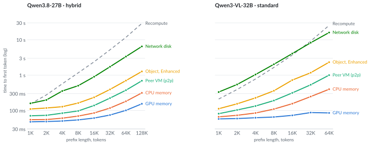
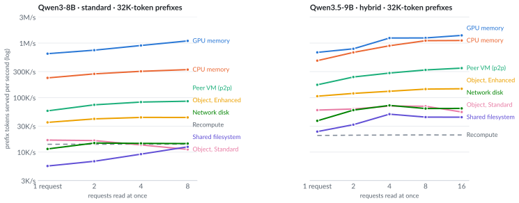

# kv-tier-bench

[](https://github.com/d-nyamkhuu/kv-tier-bench/actions/workflows/ci.yml)
[](https://d-nyamkhuu.github.io/kv-tier-bench/)
[](LICENSE)

**[Live Interactive Simulator →](https://d-nyamkhuu.github.io/kv-tier-bench/)** · **[Full Benchmark Report →](docs/report.md)** · **[Experiment Plan & Runbook →](docs/plan.md)**

**When GPU memory fills up during LLM serving, is it faster and cheaper to reload a cached KV prefix from a slower tier — or just recompute the prompt?**

In multi-turn chat, coding agents, and shared-prompt APIs, **50–95% of input tokens are repeated prefixes**. Once active conversations outgrow GPU HBM, an inference engine like **vLLM** has to either recompute evicted prefixes from scratch or offload KV blocks to cheaper tiers: **host CPU RAM, local/network SSD, Object Storage (S3), peer GPU VM memory, or a dedicated CPU KV-store node**.

`kv-tier-bench` answers which tier wins — in **time to first token (TTFT)**, **sustained throughput**, and **$/1M tokens** — through two parts:

1. **Empirical Cloud Benchmark (`src/kv_tier_bench/`, [docs/report.md](docs/report.md))** — **1,737 metric-verified data points** measured on cloud GPU VMs (NVIDIA RTX PRO 6000 Blackwell 96 GB, vLLM v0.34.0) across **7 cache tiers** and **3 stages**, comparing **standard full-attention** models (`Qwen3-VL-32B`, `Qwen3-8B`) side-by-side with **hybrid linear-attention** models (`Qwen3.8-27B`, `Qwen3.5-9B`, Gated DeltaNet 3:1).
2. **Interactive Cluster Simulator ([Live Demo](https://d-nyamkhuu.github.io/kv-tier-bench/) · [`web/`](web/index.html))** — A calibrated, browser-based discrete-event simulator that replays hours of multi-turn chat and agent traffic across multi-node GPU clusters (`H100`, `H200`, `B200`, `B300`, `GB200`), modeling continuous prefill batching, multi-tier LRU eviction, interconnect contention, and `$/1M` token unit economics next to OpenRouter provider pricing.

---

## Key Findings at a Glance

- **Offloading beats recomputing by up to 26× on long contexts.** Loading a 64K-token `Qwen3-VL-32B` prefix from a peer VM's RAM over TCP took **1.0 s** vs. **26 s** to recompute (**96%** modeled cost savings). At 128K tokens on `Qwen3.8-27B`, every tier — down to a plain network SSD — beat cold prefill.
- **Prefill doesn't gain from batching; cache loads do.** Recomputing `c` prefixes concurrently took `0.99 × c` single prefills (flat tokens/s across batch sizes), whereas every storage and memory tier overlapped reads up to its link ceiling (e.g., P2P scaling from **172K → 348K tok/s** on `Qwen3.5-9B`).
- **Model architecture (`KiB/token`) decides whether cheap storage pays off.** Standard full attention (`Qwen3-8B`: 144 KiB/tok; `Qwen3-VL-32B`: 256 KiB/tok) transfers **3.6–4.5× more KV data per token** than hybrid Gated DeltaNet models (`Qwen3.5-9B`: 32 KiB/tok; `Qwen3.8-27B`: 64 KiB/tok). On dense KV models, disk and object storage only break even at **32K–64K+ tokens**; on shorter prompts, storage fees exceed the GPU time saved.
- **Default TCP transport settings leave 3–6× throughput on the table.** Profiling NIXL/UCX and Mooncake Store over TCP uncovered single-stream descriptor merging, busy-poll lock contention, and undersized thread/slice defaults. Tuning them made long-prefix P2P pulls **5–6× faster** (up to **28 GiB/s** over TCP) and Mooncake Store reads **3.2–4.8× faster**.
- **A dedicated CPU-only KV store VM loses to peer GPU RAM over TCP.** Direct peer pulls from a second GPU VM's spare host RAM (`p2p`) ran a median **2.5× faster** than Mooncake Store on a dedicated 64-vCPU / 256 GiB VM (`store`). Over TCP, a separate store VM is only justified when the working set exceeds cluster-wide GPU host RAM or must outlive spot GPU preemption — and needs RDMA to clearly beat Object Storage on latency.
- **Synthetic `fio` numbers can mislead vLLM storage choices.** A shared `virtiofs` filesystem benchmarked **4× faster** than a network SSD in 16-way `fio` (`8.2` vs. `1.9 GiB/s`), yet lost to the plain SSD on **34 of 43** vLLM test points because vLLM's filesystem connector reads 10 MiB files across 16 threads (~`0.5 GiB/s` for one 128K prefix).

---

## Benchmark Results

Full methodology, per-tier hardware ceiling analysis, and cost sensitivity tables are in **[docs/report.md](docs/report.md)**. Experiment design, runbooks, and day-by-day debugging logs are in **[docs/plan.md](docs/plan.md)**.

| Stage | Workload | Models (KV Footprint) | Tiers Tested | Valid Points |
|---|---|---|---|---|
| **Stage 1 (`s1`)** | 1 request at a time, 1K–128K prefixes | `Qwen3.8-27B` (hybrid, 64 KiB/tok)<br>`Qwen3-VL-32B` (standard, 256 KiB/tok) | GPU, CPU, Peer VM TCP (`p2p`), Object Storage Enhanced (`obj`), Network SSD (`fs`) vs. Recompute | **390 / 390** (+ 75 re-measured `p2p`) |
| **Stage 2 (`s2`)** | Concurrent batches of 1–16 requests, 4K–128K prefixes | `Qwen3.5-9B` (hybrid, 32 KiB/tok)<br>`Qwen3-8B` (standard, 144 KiB/tok) | Stage 1 tiers + Object Storage Standard (`obj-std`) + Shared Filesystem (`fs-shared`) | **1,032 / 1,032** |
| **Stage 3 (`s3`)** | Concurrent batches of 1–16 requests, 4K–128K prefixes | `Qwen3.5-9B` & `Qwen3-8B` | Dedicated CPU-VM Mooncake Store (`store`), GPU-hosted Mooncake (`store-p2p`), Peer VM (`p2p`) | **315 / 315** |

### Stage 1: Single-Request Latency & Cost Savings

<picture>
  <source media="(prefers-color-scheme: dark)" srcset="docs/figures/s1-load-time-dark.svg">
  
</picture>

*Median time to first token (TTFT) at each model's longest tested prefix, with modeled cost savings vs. cold recompute (Nebius `eu-south1`):*

| Cache Tier | `Qwen3.8-27B` (128K prefix, 8 GiB KV) | `Qwen3-VL-32B` (64K prefix, 16 GiB KV) |
|---|---|---|
| **GPU memory (HBM)** | **0.15 s** (99% saved) | **0.085 s** (100% saved) |
| **Local CPU memory** | **0.31 s** (99% saved) | **0.40 s** (98% saved) |
| **Peer VM RAM over TCP (`p2p`)** | **0.69 s** (98% saved, 23 GiB/s) | **1.00 s** (96% saved, 28 GiB/s) |
| **Object Storage (Enhanced)** | **1.3 s** (87% saved, 10 GiB/s) | **2.3 s** (72% saved, 9 GiB/s) |
| **Network SSD** | **6.5 s** (74% saved, 1.3 GiB/s) | **16 s** (28% saved, 1.0 GiB/s) |
| **Cold Recompute** | 30 s | 26 s |

### Stage 2: Concurrent Batch Scaling (1–16 Requests)

<picture>
  <source media="(prefers-color-scheme: dark)" srcset="docs/figures/s2-throughput-dark.svg">
  
</picture>

*Single 128K-token prefix baseline in `s2` (Nebius `us-central1`), showing how dense vs. hybrid KV sizes shift tier economics:*

| Cache Tier | `Qwen3-8B` (standard, 144 KiB/tok) | `Qwen3.5-9B` (hybrid, 32 KiB/tok) |
|---|---|---|
| **GPU memory (HBM)** | 0.14 s (99% saved) | 0.12 s (99% saved) |
| **Local CPU memory** | 0.50 s (98% saved) | 0.21 s (98% saved) |
| **Peer VM RAM over TCP (`p2p`)** | 2.1 s (90% saved) | 0.66 s (93% saved) |
| **Object Storage (Enhanced)** | 3.5 s (58% saved) | 1.2 s (73% saved) |
| **Object Storage (Standard)** | 11 s (47% saved) | 2.0 s (76% saved) |
| **Network SSD** | 13 s (28% saved) | 2.5 s (66% saved) |
| **Shared Filesystem (`virtiofs`)** | 37 s (−91%, slower than recompute) | 8.1 s (1% saved) |
| **Cold Recompute** | 22 s | 9.1 s |

> **Regional note:** `p2p` in `us-central1` hit an unexplained host/UCX ceiling of `10–12 GiB/s` despite `27 GiB/s` `iperf3` between VMs. Re-running the same models in `eu-south1` during Stage 3 restored `p2p` to a median **1.2×–1.6× faster** (up to `21.4 GiB/s` batch end-to-end).

### Stage 3: Dedicated CPU KV Store (Mooncake) vs. Peer GPU RAM

*Batch wall time and end-to-end transfer rate comparing native NIXL `p2p` (second GPU VM's RAM) against `MooncakeStoreConnector` on a dedicated 64-vCPU / 256 GiB CPU VM (`eu-south1`):*

| Prefix × Batch | `Qwen3-8B` `p2p` | `Qwen3-8B` Mooncake Store | `Qwen3.5-9B` `p2p` | `Qwen3.5-9B` Mooncake Store |
|---|---|---|---|---|
| **4K × 1** | 0.093 s (6.1 GiB/s) | 0.158 s (3.6 GiB/s) | 0.045 s (3.3 GiB/s) | 0.062 s (2.3 GiB/s) |
| **16K × 16** | 2.4 s (14.9 GiB/s) | 7.3 s (4.9 GiB/s) | 0.50 s (17.0 GiB/s) | 1.6 s (5.2 GiB/s) |
| **128K × 1** | 1.7 s (10.5 GiB/s) | 4.0 s (4.5 GiB/s) | 0.31 s (12.9 GiB/s) | 0.78 s (5.2 GiB/s) |

At production reuse (~100+ reads/hour of a 128K prefix), every remote tier cuts cost by **68–91%** against recompute — but local GPU-host RAM saves more for free, and on `Qwen3-8B` Enhanced Object Storage matches or beats the CPU store VM on latency and cost at **1/55th** the price per GiB ([cost analysis](docs/report.md#cost-at-production-reuse)).

---

## Systems & Engineering Highlights

- **5–6× NIXL/UCX P2P Speedup (`scripts/nixl_patch/`):** Out of the box, vLLM v0.34.0's P2P tier underutilized 400 Gbps NICs over TCP for three reasons:
  1. NIXL merges contiguous KV block descriptors by default, collapsing a 292-block 128K prefix into ~1 descriptor — below `split_batch_size=1024`, forcing single-stream TCP.
  2. Python `nixl_agent` hardcodes `pthrDelay=0`, causing progress threads to busy-spin in `poll(0)` and starve UCX worker locks.
  3. Each UCX TCP agent receives on a single core.
  
  A container `sitecustomize.py` hook disables descriptor merging, enables event-fd sleep, and stripes pulls across **32 NIXL agents**, lifting long-prefix TCP pulls to **23–28 GiB/s** (and resolving a missing `libcuobjclient.so.1` dependency in `nixl_cu13` by routing host-memory `obj` transfers through `nixl_cu12`).
- **Write-Once, Reset-Above Measurement Protocol (`src/kv_tier_bench/measure.py`):** Prefilling every data point from scratch on 30B models would waste hours of GPU spend. Instead, each prefix is prefilled once so vLLM writes through to all configured tiers; before each repetition, upper caches are selectively cleared so reads must come from the target tier. Every run is **strictly validated against vLLM's Prometheus token-source counters** (plus Mooncake's byte counters in `s3`) — any rep with cache bleed or partial eviction is rejected.
- **Hardware Ceiling Attribution:** Fits single-request transfer times as `time = fixed_overhead + bytes / rate` (`R² = 0.997–1.000`) against PCIe 5.0 (`58.7 GiB/s`), `iperf3`, and `fio` baselines ([ceiling breakdown](docs/report.md#how-close-to-the-ceiling)), isolating vLLM's `46–62 ms` scheduling floor and showing where P2P serializes network pulls with host-to-GPU PCIe copies.
- **Preemption-Safe Spot Orchestration (`scripts/sweep.sh`, `scripts/vms.sh`):** Automates multi-VM Docker launches, Hugging Face weight staging, tier cache wiping (`O_DIRECT` / page-cache checks), and per-deployment JSONL checkpointing to Object Storage so interrupted spot sweeps resume cleanly without repeating completed points.

---

## Interactive KV-Cache Cluster Simulator (`web/`)

The **[live browser simulator](https://d-nyamkhuu.github.io/kv-tier-bench/)** (source in [`web/`](web/index.html)) extends the empirical single-node measurements to full multi-node production clusters using a zero-dependency discrete-event engine running in a Web Worker.

### What It Models

- **13 Open-Weight Architectures:** Includes `Qwen3.8-2.4T-A95B`, `Qwen3-235B-A22B`, `Kimi K3`, `DeepSeek V4.1 Flash`, `GLM-5.3`, `GLM-5.3-Flash`, `Qwen3.8-Flash-Next`, `MiniMax-M3`, `Mistral Large 4`, `gpt-oss-120b`, `Gemma 4 31B`, plus `s1`'s `Qwen3.8-27B` and `Qwen3-VL-32B`. Automatically derives KV bytes/token, fixed recurrent/linear state, and prefill FLOPs from `config.json` across **GQA, MLA, MoE, sliding-window, sparse, and hybrid linear attention**, auto-scaling Tensor Parallelism (intra-node) and Pipeline Parallelism (inter-node) across `RTX PRO 6000`, `L40S`, `H100`, `H200`, `B200`, `B300`, `GH200`, `GB200`, and `VR200` GPUs.
- **Realistic Traffic & Real Trace Replay:** Grounded in production prefix-cache studies — [DeepSeek's 56.3% disk hit rate](https://github.com/deepseek-ai/open-infra-index/blob/main/202502OpenSourceWeek/day_6_one_more_thing_deepseekV3R1_inference_system_overview.md), SGLang's 52–74% on Chatbot Arena, and [Alibaba's 54–62% chat/API traces](https://arxiv.org/abs/2506.02634) (85–97% for coding agents). Supports configurable synthetic Zipf multi-tenant traffic, one-click **Mooncake FAST'25 traces** (conversation, tool/coding agent, arXiv), or **uploading custom JSONL/JSON block-hash traces**, capturing cold turns, unshared system prompts, context truncation, history edits, bounded **S3 bucket capacity & S3 object retention TTLs**, hosted-API TTLs, and round-robin / sticky / random routing.
- **Continuous Prefill Batching, Speculative & Wide-EP Decode:** Models chunked prefill steps (default `8,192` tokens/step, calibrated against `s1` and published InferenceX vLLM runs — see [docs/design/prefill-batching.md](docs/design/prefill-batching.md) and [docs/lmcache-compatibility.md](docs/lmcache-compatibility.md)), overlapping storage reads with compute while accounting for per-GPU RDMA / Ethernet NIC and disk contention, speculative decoding (`MTP`, `EAGLE-3`, `DFlash`, `DSpark`), and wide expert-parallel decode (`EP16`–`EP144` with DeepEP communication).
- **Live Unit Economics vs. OpenRouter & Built-In Validation:** Reports mean/p50/p90/p99 TTFT, per-user decode `tok/s`, interactive minute-by-minute tier occupancy timelines (exportable to CSV), progressive single-tier comparisons, `$/1M` **input, cached-input, and output** token costs alongside dated OpenRouter medians, and an expandable **Sources, assumptions & benchmark validation** audit table. Every configuration encodes cleanly into the URL hash for sharing.

Five built-in presets (*Every tier in use*, *Long chats*, *Plenty of GPU memory*, *GPU cache fills*, and *SSD fills*) let you explore common bottlenecks in one click.

---

## Quick Start (No GPU Needed)

Everything in the CLI analysis suite, test suites, and web simulator runs locally on a laptop without GPUs.

### 1. Run the Interactive Web Simulator

```bash
python -m http.server -d web
# Open http://localhost:8000 in your browser
```

Run the simulator's Node.js test suite (calibration, discrete-event engine, pricing, and sanity checks):

```bash
node --test "web/test/*.test.js"
```

### 2. Explore Benchmark Data & CLI (`kvtb`)

Requires Python 3.12+ and [`uv`](https://docs.astral.sh/uv/):

```bash
uv sync

# Inspect exact KV bytes/token and recurrent state sizes derived from model configs
uv run kvtb sizes

# Print measured latency, bandwidth, and modeled $/1M token tables for any stage
uv run kvtb cost --stage s1 --results results/s1.jsonl
uv run kvtb cost --stage s2 --results results/s2.jsonl
uv run kvtb cost --stage s3 --results results/s3.jsonl

# Preview the exact Docker + vLLM launch command or remaining sweep matrix
uv run kvtb serve-cmd --stage s1 --model qwen3.8-27b --deploy fs --host-ip 10.0.0.5
uv run kvtb run --stage s1 --model qwen3.8-27b --deploy fs --dry-run

# Rebuild aggregated report JSONs and dark/light SVG figures
uv run python scripts/export-report-data.py
uv run python scripts/report-figures.py

# Run Python lint and unit tests
make lint && make test
```

---

## Repository Structure

```text
├── src/kv_tier_bench/   # Python CLI (`kvtb`): KV sizing, sweep runner, Prometheus validator, cost & chart builders
├── web/                 # Zero-build interactive KV-cache cluster simulator (HTML/CSS/ES modules + Web Worker)
├── scripts/             # Cloud VM provisioning (`vms.sh`), spot-resumable sweep (`sweep.sh`), Mooncake setup,
│   └── nixl_patch/      # Container `sitecustomize` hook: 32-agent NIXL TCP striping & UCX poll fix
├── configs/             # Stage matrices (`experiment.yaml`) and sourced cloud pricing (`prices.yaml`)
├── results/             # Raw validated benchmark runs (`s1.jsonl`, `s2.jsonl`, `s3.jsonl`), `fio` logs, charts
├── docs/
│   ├── report.md        # Full benchmark write-up, figures, ceiling math, and cost tables
│   ├── plan.md          # Experimental protocol, VM runbook, day-1 checks, and debugging notes
│   ├── design/          # Prefill batching step model & calibration notes
│   └── lmcache-compatibility.md
└── tests/               # Python unit tests (`pytest`); JS simulator tests live in `web/test/`
```

---

## Known Scope & Limitations

- **Cloud TCP & Network Block Storage:** Measured on Nebius `RTX PRO 6000 Blackwell` VMs (`TP=1`) connected over TCP (no InfiniBand/RDMA, no local NVMe on this VM SKU). Disk numbers reflect a 1,767 GiB non-replicated network SSD (`2 GiB/s` read cap, verified with `O_DIRECT` and `fio`).
- **Object Storage Warmth:** Prefixes are read back seconds to minutes after write; cold objects evicted from provider-side front-end caches hours later may exhibit higher latency.
- **Isolated Prefill/Load Benchmarks:** Cloud sweeps (`s1`–`s3`) isolate prefix loading without concurrent background decode traffic (mixed prefill/decode contention is modeled in [`web/`](web/index.html)).
- **Modeled Cost Assumptions:** Dollar savings combine **measured** wall times with **modeled** Nebius on-demand pricing (`$1.80/GPU-h`, 1-hour retention in `s1`/`s2`, parameterized reuse rates in `s3`; Standard S3 per-request fees omitted in `s2` tables, included in the web simulator).
- **Precision & Modality:** Text-only prompts; hybrid linear-attention recurrent state is stored in `bf16` rather than Hugging Face's `fp32` default.
