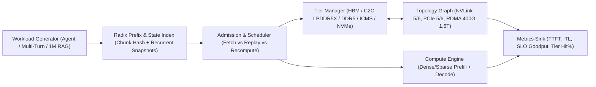
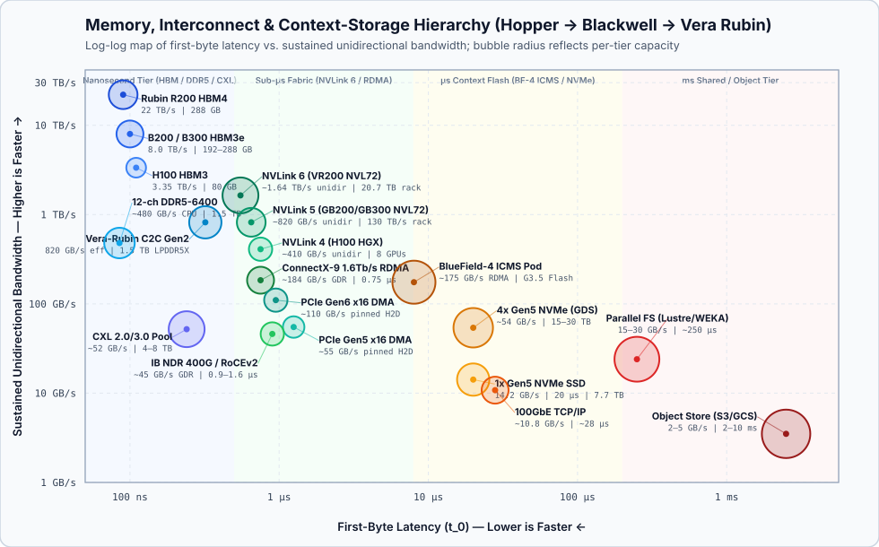
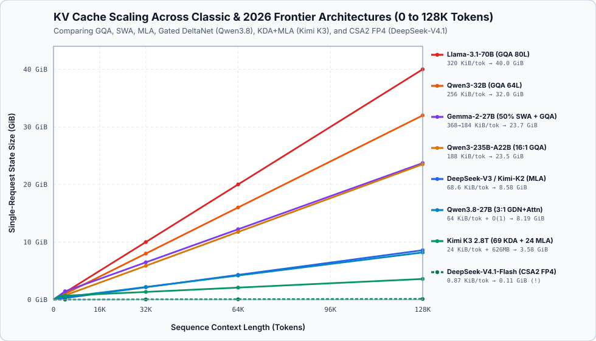
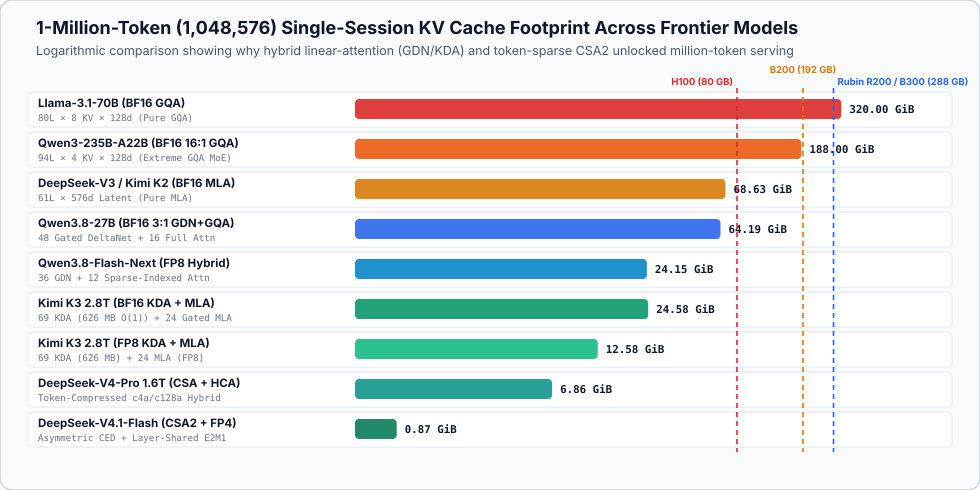
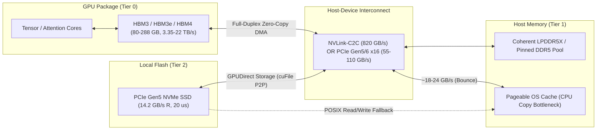
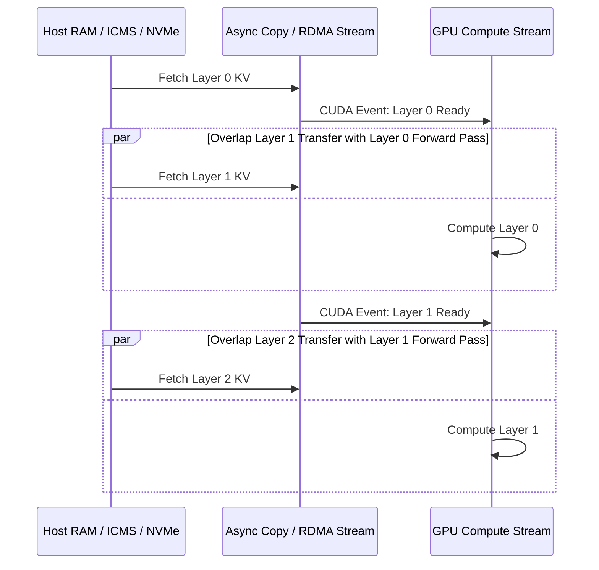
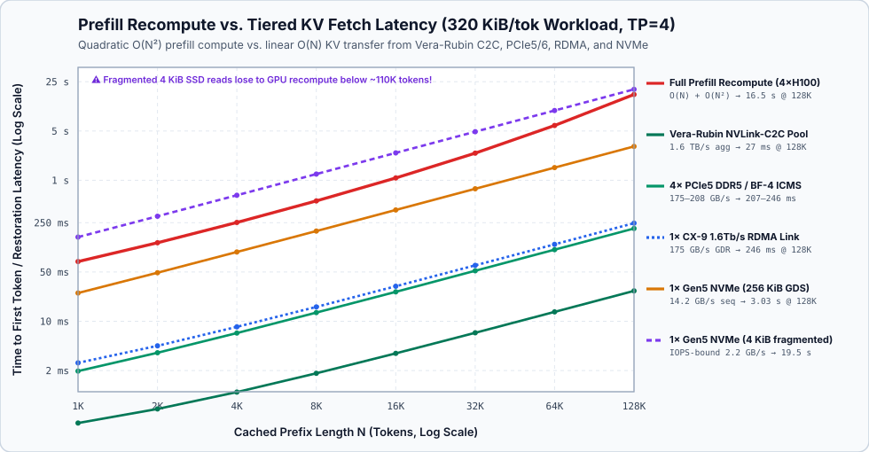
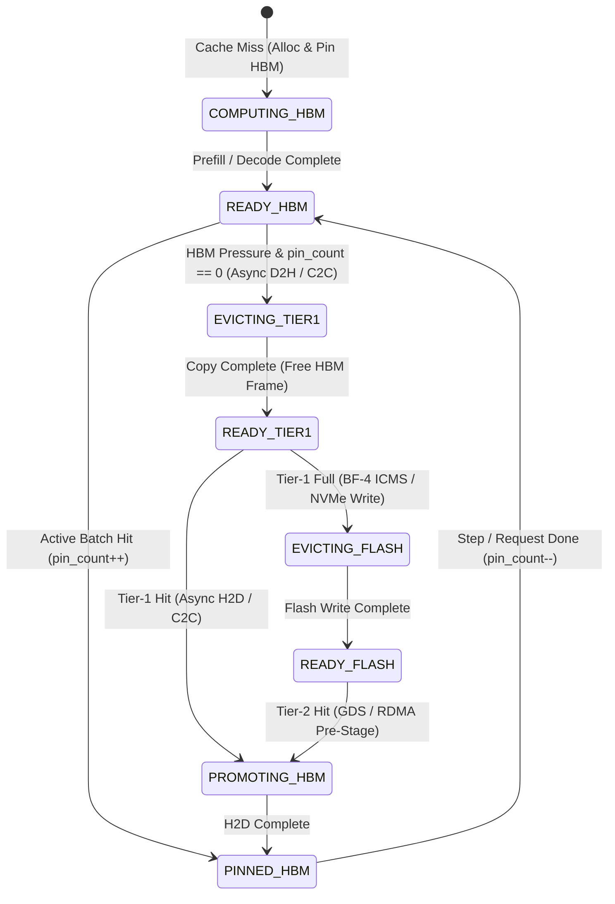
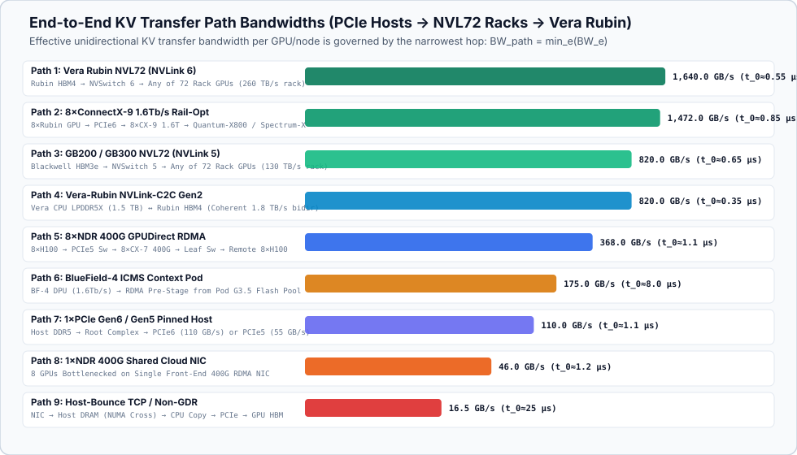
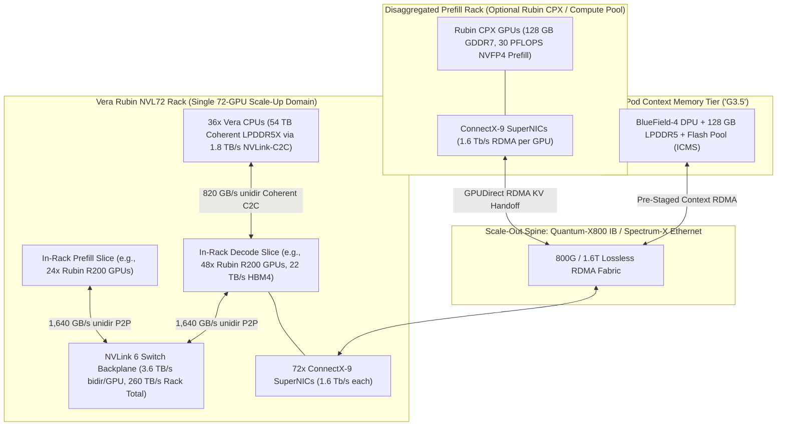

# How to Build a KV Cache Simulator: From Single-GPU Storage Tiers to Vera Rubin NVL72 & 1M-Context Models

Building an accurate **Key-Value (KV) cache simulator** requires bridging two rapidly evolving worlds: **LLM transformer & hybrid-state mathematics** (how MHA, GQA, MLA, Gated DeltaNet, Kimi Delta Attention, and Compressed Sparse Attention allocate, share, and compress state) and **computer systems physics** (how HBM3e/HBM4, NVLink-C2C LPDDR5X, DDR5, CXL, BlueField-4 context flash, NVMe SSDs, NVLink 5/6, and 400G–1.6T RDMA fabrics move bytes under latency, bandwidth, IOPS, and queueing constraints).

This guide walks step-by-step through designing and implementing a fidelity-graded KV cache simulator from scratch using independently verified hardware and model specifications—spanning classic baselines (`Llama-3.1`, `Gemma-2`, `DeepSeek-V3`) through 2025–2026 frontier architectures (`Qwen3`, `Qwen3.8`, `Kimi K2/K3`, `DeepSeek-V4 / V4.1`) and modern systems (`Blackwell GB200/GB300 NVL72`, `Vera Rubin VR200 NVL72`, `Rubin CPX`, and `BlueField-4 ICMS`).

---

## Table of Contents

1. [Why Simulate KV Cache Tiering & Simulator Architecture](#1-why-simulate-kv-cache-tiering--simulator-architecture)
2. [Storage & Interconnect Physics: Hopper to Vera Rubin & NVL72](#2-storage--interconnect-physics-hopper-to-vera-rubin--nvl72)
3. [Model Architecture Math: From MHA & GQA to Kimi K3, Qwen3.8 & DeepSeek-V4.1](#3-model-architecture-math-from-mha--gqa-to-kimi-k3-qwen38--deepseek-v41)
4. [Stage 1: Single GPU with Multi-Tier Local Storage](#4-stage-1-single-gpu-with-multi-tier-local-storage)
5. [Stage 2: Single Node, Multi-GPU (TP, PP, DP-Attention, NUMA & NVSwitch)](#5-stage-2-single-node-multi-gpu-tp-pp-dp-attention-numa--nvswitch)
6. [Stage 3: Multi-Node Fabrics, NVL72 Rack Domains & Disaggregated Serving](#6-stage-3-multi-node-fabrics-nvl72-rack-domains--disaggregated-serving)
7. [Calibration, Validation & Simulator Output Metrics](#7-calibration-validation--simulator-output-metrics)

---

## 1. Why Simulate KV Cache Tiering & Simulator Architecture

### 1.1 The Two Phases of LLM Inference

Autoregressive LLM serving splits every request into two distinct hardware regimes:

1. **Prefill Phase (Compute-Bound):** Processes all $N$ input prompt tokens in parallel to populate initial attention KV caches (and recurrent linear-attention states). Arithmetic intensity is high; latency scales as $\mathcal{O}(N) + \mathcal{O}(N^2)$ for dense attention and governs **Time to First Token (TTFT)**.
2. **Decode Phase (Memory-Bandwidth-Bound):** Generates output tokens one step at a time. Each step must stream active model weights *plus* the entire historical KV state of all active batch sequences from GPU High Bandwidth Memory (HBM), governing **Time Per Output Token (TPOT)** / **Inter-Token Latency (ITL)**.

In multi-turn reasoning loops, coding agents, and RAG workflows, **65%–95% of input tokens are repeated prefixes** across turns or requests. Caching and reusing these states eliminates redundant prefill FLOPs—but even 192–288 GB of HBM fills rapidly under high concurrency and 128K–1M context windows. Offloading inactive KV blocks across **coherent CPU LPDDR5X, DDR5, CXL pools, DPU-managed context flash, local NVMe SSDs, or remote RDMA peers** turns inference serving into a hierarchical memory-and-network scheduling problem.

### 1.2 Why Spreadsheet Formulas Fail (and Why You Need Discrete-Event Simulation)

Static division ($T = \text{Bytes} / \text{Bandwidth}$) fails in real clusters for five reasons:

* **Link Contention & Queueing:** Promoting a cached prefix over PCIe or RDMA competes with concurrent background evictions and sibling GPU transfers sharing the same switch edge.
* **Granularity & IOPS Ceilings:** Reading 64 MiB as 256 KiB chunks saturates a Gen5 NVMe SSD at 14.2 GB/s; reading the same 64 MiB as scattered 4 KiB layer pages collapses below 2.5 GB/s.
* **Layer-Wise Compute–Transfer Overlap:** Engines pipeline Layer $l+1$'s DMA transfer behind Layer $l$'s GPU forward pass, hiding transfer latency until I/O exceeds per-layer compute.
* **Heterogeneous Hybrid States:** Modern architectures (`Kimi K3`, `Qwen3.8`, `DeepSeek-V4.1`) mix $\mathcal{O}(N)$ paged KV blocks with $\mathcal{O}(1)$ recurrent state snapshots and cross-layer sparse indexers that have completely different checkpoint and replay rules.
* **Dynamic Recompute-vs-Fetch Crossovers:** Under heavy I/O queue depth, recomputing a short prefix (or replaying a local sliding window) on Tensor Cores can beat waiting on congested storage.

### 1.3 Modular Simulator Architecture

Build your simulator around **Discrete-Event Simulation (DES)**—a min-heap priority queue of timestamped events advancing a virtual clock `now_us`:



---

## 2. Storage & Interconnect Physics: Hopper to Vera Rubin & NVL72

Every memory tier or fabric link in your simulator is governed by four physical parameters: **capacity**, **first-byte latency ($t_0$)**, **sustained unidirectional bandwidth ($\text{BW}_{\text{eff}}$)**, and **random request rate ($\text{IOPS}_{\max}$)**.



### 2.1 Reference Hardware Specifications Table (Hopper, Blackwell, Blackwell Ultra & Vera Rubin)

Parameterize your simulator with **sustained effective unidirectional throughput** (typically 80%–92% of raw line rate due to framing, ECC, and DMA ring overhead) rather than raw marketing peak numbers:

| Tier / Interconnect | Representative Hardware | Capacity (Per Unit / Domain) | First-Byte Latency ($t_0$) | Peak Raw BW (Unidir) | Sustained Effective BW (Unidir) | Random 4 KiB Limit (IOPS) |
| :--- | :--- | :---: | :---: | :---: | :---: | :---: |
| **GPU HBM4 (Tier 0)** | **NVIDIA Vera Rubin R200** | **288 GB / GPU** (20.7 TB / NVL72) | ~90 ns | **22,000 GB/s** | ~19,500 GB/s | Cacheline |
| **GPU HBM3e (Tier 0)** | **NVIDIA B300 (Blackwell Ultra)** | **288 GB / GPU** (~20 TB / NVL72) | ~100 ns | 8,000 GB/s | ~7,000 GB/s | Cacheline |
| **GPU HBM3e (Tier 0)** | **NVIDIA B200** / AMD MI355X | 180–192 GB (B200) / 288 GB (MI355X) | ~100 ns | 8,000 GB/s | ~7,000 GB/s | Cacheline |
| **GPU HBM3 (Tier 0)** | NVIDIA H100 SXM | 80 GB / GPU | ~110 ns | 3,350 GB/s | ~2,950 GB/s | Cacheline |
| **Prefill GDDR7 (Tier 0p)** | **NVIDIA Rubin CPX** (Prefill GPU) | **128 GB GDDR7** / GPU | ~130 ns | ~1,500–2,000 GB/s | Compute-specialized | Cacheline |
| **NVLink-C2C Gen 2 (Tier 1a)** | **Vera CPU ↔ Rubin GPU (LPDDR5X)** | **1.5 TB / Vera CPU** (54 TB / NVL72) | ~300–350 ns | **900 GB/s** (1.8 TB/s bidir) | **~820 GB/s** | Cacheline (Coherent) |
| **NVLink-C2C Gen 1 (Tier 1a)** | Grace CPU ↔ Hopper/Blackwell | 480 GB / Grace CPU | ~350–400 ns | 450 GB/s (900 GB/s bidir) | ~410 GB/s | Cacheline (Coherent) |
| **Local Host DDR5 (Tier 1b)** | 12-ch DDR5-6400 x86 Server Socket | 512 GB – 2 TB / socket | ~85 ns (CPU) | ~614 GB/s (CPU) | **~110 GB/s (PCIe6)** / **~55 GB/s (PCIe5)** | N/A |
| **CXL Memory Pool (Tier 1c)** | CXL 2.0/3.0 Expander (PCIe5/6 x16) | 2 TB – 8 TB | ~200–300 ns | 64–128 GB/s | ~52–105 GB/s | N/A |
| **NVLink 6 Scale-Up** | **Vera Rubin NVL72** (72 GPUs / 144 dies) | **20.7 TB HBM4** rack pool | ~0.5–0.6 µs | **1,800 GB/s** (3.6 TB/s bidir) | **~1,640 GB/s / GPU** (260 TB/s rack) | Memory-semantic |
| **NVLink 5 Scale-Up** | **GB200 / GB300 NVL72** (72 GPUs) | 13.8–20 TB HBM3e rack pool | ~0.6–0.7 µs | 900 GB/s (1.8 TB/s bidir) | **~820 GB/s / GPU** (130 TB/s rack) | Memory-semantic |
| **NVLink 4 Intra-Node** | H100 HGX NVSwitch (8 GPUs) | 640 GB HBM3 node pool | ~0.75 µs | 450 GB/s (900 GB/s bidir) | ~410 GB/s / GPU | Memory-semantic |
| **1.6 Tb/s RDMA Fabric** | **ConnectX-9 + Quantum-X800 / Spectrum-X** | Cluster-wide | ~0.7–0.85 µs | **200 GB/s** (1.6 Tb/s) | **~184 GB/s** (GPUDirect) | ~250M+ msg/s |
| **800 Gb/s XDR RDMA** | ConnectX-8 + InfiniBand XDR | Cluster-wide | ~0.8–0.9 µs | 100 GB/s | ~92 GB/s (GPUDirect) | ~150M+ msg/s |
| **400 Gb/s NDR / RoCEv2** | ConnectX-7 (IB NDR / Lossless 400GbE) | Cluster-wide | ~0.9–1.8 µs | 50 GB/s | ~44–46 GB/s (GPUDirect) | ~80M–100M msg/s |
| **DPU Context Pod ("G3.5")** | **BlueField-4 ICMS** (128 GB LPDDR5 + Flash) | Pod-scale (100s TB) | ~6–12 µs (staged) | 100–200 GB/s (800G–1.6T) | **~90–175 GB/s** RDMA | Hardware-offloaded |
| **Local Gen5 NVMe (Tier 2)** | Enterprise PCIe Gen5 x4 SSD | 3.84 – 15.36 TB | ~15–25 µs | 15.7 GB/s | **14.2 GB/s** (R) / **12.0 GB/s** (W) | 2.4M R / 1.2M W |
| **4× Gen5 NVMe RAID0 + GDS** | 4× PCIe5 x4 SSDs (GPUDirect Storage) | 15 – 60 TB | ~20–30 µs | 63 GB/s | ~54 GB/s (PCIe5) / ~57 GB/s (PCIe6) | ~9M R |
| **Parallel FS / Object (Tier 3/4)** | Lustre / WEKA / S3 | PB – EB | 250 µs – 5 ms | Elastic | 15–30 GB/s (FS) / 2–5 GB/s (S3) | Metadata / API bound |

> [!IMPORTANT]
> **Always Normalize Bidirectional Quotes in Code:** Hardware specs quote **NVLink 6** (`3.6 TB/s`), **NVLink 5** (`1.8 TB/s`), **NVLink-C2C Gen 2** (`1.8 TB/s`), **PCIe Gen6 x16** (`256 GB/s`), and **PCIe Gen5 x16** (`128 GB/s`) as *bidirectional totals*, whereas **NICs** (`1.6 Tb/s = 200 GB/s`) and **SSDs** (`14.2 GB/s`) are quoted *unidirectionally*. Store separate `h2d_bw_gbs` and `d2h_bw_gbs` (~half the bidirectional figure $\times$ protocol efficiency) so your simulator never overstates PCIe or NVLink throughput by $2\times$.

### 2.2 The Universal Device Transfer Equation

Model transferring a payload of $B$ bytes split into physical I/O chunks of size $S_{\text{io}}$ with a unified latency + bandwidth + IOPS roofline:

$$T_{\text{transfer}}(B, S_{\text{io}}) = t_0 + \max\!\left(\frac{B}{\text{BW}_{\text{eff}}(S_{\text{io}})},\; \frac{\lceil B / S_{\text{io}} \rceil}{\text{IOPS}_{\max}}\right)$$

* **Example (Chunk Coalescing Impact):** Fetching $64\text{ MiB}$ from a Gen5 NVMe SSD ($t_0 = 20\text{ }\mu\text{s}$, $\text{BW}_{\text{eff}} = 14.2\text{ GB/s}$, $\text{IOPS}_{\max} = 2.2\times 10^6$) takes **4.75 ms** with $S_{\text{io}} = 256\text{ KiB}$ chunks ($256$ I/Os), but degrades to **7.47–27.3 ms** with uncoalesced $S_{\text{io}} = 4\text{ KiB}$ per-layer pages ($16,384$ scattered I/Os).

### 2.3 Next-Gen Context Memory Tiers: Vera-Rubin NVLink-C2C & BlueField-4 ICMS ("G3.5")

Modern AI racks introduce two purpose-built hardware tiers specifically engineered for agentic KV caching that your simulator should model as first-class presets:

1. **Coherent Superchip LPDDR5X (`Grace-Blackwell` & `Vera-Rubin NVLink-C2C`):** Unlike x86 servers throttled by PCIe x16 (55–110 GB/s), each NVIDIA Vera CPU pairs with Rubin GPUs over **1.8 TB/s bidirectional (`~820 GB/s` unidirectional effective) hardware-coherent NVLink-C2C**, exposing **54 TB of rack LPDDR5X** across an NVL72 rack. A GPU kernel can load/store cold KV pages directly across C2C at **15× the bandwidth of PCIe Gen5** without explicit host staging buffers.
2. **BlueField-4 Inference Context Memory Storage (`ICMS` / "G3.5" Tier):** Sits between DRAM (Tier 1) and traditional storage (Tier 3). A 64-core **BlueField-4 DPU** (with 128 GB onboard LPDDR5 and `800 Gb/s–1.6 Tb/s` RDMA) manages a pod-level flash pool exclusively for ephemeral KV context blocks—pre-staging predicted conversation turns into LPDDR5 and pushing them via GPUDirect RDMA into GPU HBM in single-digit microseconds before decode stalls occur.

---

## 3. Model Architecture Math: From MHA & GQA to Kimi K3, Qwen3.8 & DeepSeek-V4.1

A simulator must compute KV cache state directly from architectural parameters rather than total weight count. Across 2024–2026 architectures, **per-token KV cache size varies by more than $900\times$** between classic MHA (`800 KiB/tok`) and modern sparse/compressed hybrids (`0.87 KiB/tok` in `DeepSeek-V4.1-Flash`)!



### 3.1 Six Architectural Paradigms Your Simulator Must Support

Let $b_{\text{elem}}$ denote effective bytes per stored value (`2.0` for BF16/FP16, `1.0` for FP8, `0.5625` for INT4/FP4 with per-16-channel 8-bit scales).

#### Paradigm 1 & 2: MHA, GQA, and Extreme-Ratio MoE GQA (`Llama-3.1`, `Qwen3`)

Standard attention caches 1 Key and 1 Value vector per KV head $h_{kv}$ across $L$ layers:

$$B_{\text{tok}}^{\text{GQA}} = 2 \times L \times h_{kv} \times d_h \times b_{\text{elem}}$$

* **Classic Dense GQA:** `Llama-3.1-70B` ($L=80, h_{kv}=8, d_h=128 \implies 320\text{ KiB/tok}$ BF16); **`Qwen3-8B`** ($L=36, h_{kv}=8, d_h=128 \implies 144\text{ KiB/tok}$); **`Qwen3-32B`** ($L=64, h_{kv}=8, d_h=128 \implies 256\text{ KiB/tok}$).
* **Extreme-Ratio MoE GQA (`Qwen3-235B-A22B`):** Uses a **16:1 GQA ratio** ($h_q=64$ query heads sharing just $h_{kv}=4$ KV heads across $L=94$ layers, $d_h=128$), holding its BF16 cache to $2 \times 94 \times 4 \times 128 \times 2 = \mathbf{192,512\text{ B/tok}}$ (`188.0 KiB/tok`)—smaller than dense 32B/70B models despite having 235B parameters!

> [!WARNING]
> **Pitfall #1 — Decoupled `head_dim`:** Never hardcode `head_dim = hidden_size // num_attention_heads`. In **`Qwen3-8B`** (`hidden_size = 4096, h_q = 32` $\to 128$), **`Qwen3-235B-A22B`** (`hidden_size = 4096, h_q = 64` $\to 64$, yet explicit `"head_dim": 128`!), and **`Gemma-2-27B`** (`hidden_size = 4608, h_q = 32` $\to 144$, yet explicit `"head_dim": 128`!), `head_dim` is decoupled from `hidden_size / h_q`. Always read `config.head_dim` first!

#### Paradigm 3: Sliding Window Attention (SWA) & Interleaved Local/Global (`Gemma-2`, `Mistral`)

Interleaved SWA models alternate $L_{\text{global}}$ full-context layers with $L_{\text{local}}$ local layers capped at window $W$ (e.g., `Gemma-2-27B`: $23$ global + $23$ local at $W=4096$):

$$M_{\text{total}}^{\text{SWA}}(N) = \Big(L_{\text{global}} \cdot N + L_{\text{local}} \cdot \min(N, W)\Big) \times 2 \times h_{kv} \times d_h \times b_{\text{elem}}$$

#### Paradigm 4: Multi-head Latent Attention — MLA & NoPE-MLA (`DeepSeek-V3`, `Kimi K2 / K2.5`)

MLA compresses all KV heads jointly into a single low-rank latent vector $c_t^{KV} \in \mathbb{R}^{d_c}$ (`kv_lora_rank = 512`) plus an optional shared decoupled RoPE key $k_t^R \in \mathbb{R}^{d_r}$ (`qk_rope_head_dim = 64`). Notice there is **no factor of 2** and **no multiplication by $h_{kv}$**:

$$B_{\text{tok}}^{\text{MLA}} = L \times \Big(d_c + (1 - \mathbb{I}_{\text{NoPE}}) d_r\Big) \times b_{\text{elem}}$$

* **`DeepSeek-V3` (671B MoE) & `Kimi K2 / K2.5` (1.04T MoE, 32B active):** Both use $L = 61$, $d_c = 512$, $d_r = 64 \implies 61 \times 576 \times 2 = \mathbf{70,272\text{ B/tok}}$ (`68.63 KiB/tok` BF16; `34.31 KiB/tok` in FP8).
* **NoPE-MLA (`mla_use_nope: true`):** When positional encoding is omitted inside MLA layers (relying on causal masking + interleaved recurrent layers, as in `Kimi K3`), only the $d_c = 512$ latent is stored per MLA layer (`1,024 B/tok/layer` in BF16, `512 B/tok/layer` in FP8).

#### Paradigm 5: Hybrid Linear-Attention + Full/MLA Stacks (`Qwen3.8`, `Kimi K3`, `Jamba-1.5`)

To break the 1-million-token memory wall without losing exact long-range retrieval, 2025–2026 frontier models replace 70%–85% of full-attention layers with **expressive linear-attention / delta-rule recurrent layers** (`Gated DeltaNet` in `Qwen3.5/3.8`, `Kimi Delta Attention [KDA]` in `Kimi K3`, `Mamba-2` in `Jamba`/`Nemotron-H`):

$$M_{\text{total}}^{\text{Hybrid}}(N) = \underbrace{N \times L_{\text{attn}} \times B_{\text{tok, layer}}^{\text{attn}}}_{\text{Grows linearly } \mathcal{O}(N)} \;+\; \underbrace{L_{\text{linear}} \times S_{\text{state}}^{\text{linear}}}_{\text{Constant } \mathcal{O}(1) \text{ regardless of } N!}$$

* **`Qwen3.8-27B` (`3:1 Gated DeltaNet + GQA`):** `config.json` sets `full_attention_interval: 4`, repeating `["linear_attention", "linear_attention", "linear_attention", "full_attention"]` across 64 layers:
  * **48 Gated DeltaNet (GDN) layers:** Zero per-token KV cache! Each layer holds a fixed recurrent matrix (`linear_num_value_heads * d_k * d_v`) + 4-step `conv1d` state ($\sim 4\text{ MiB/layer} \approx 192\text{ MiB}$ total).
  * **16 Full-Attention GQA layers:** $h_q=24, h_{kv}=4, d_h=256 \implies 2 \times 16 \times 4 \times 256 \times 2 = \mathbf{65,536\text{ B/tok}}$ (`64.0 KiB/tok` BF16).
* **`Qwen3.8-Flash-Next` (`36 GDN + 12 Sparse-Indexed Attention`):** 48 total layers (3:1 split) with `head_dim = 256` and sparse attention top-$k$ indexing (`indexer_budget: 2048`), cutting FP8 KV growth to **24.0 KiB/tok**.
* **`Kimi K3` (`2.8T MoE, 104B active, kimi_linear`):** Combines **Paradigm 4 (MLA) + Paradigm 5 (KDA)** across 93 layers:
  * **69 Kimi Delta Attention (KDA) layers:** **0 bytes/token growth**—maintains a fixed **~626 MB** (`~597 MiB`) recurrent + `short_conv_kernel_size=4` state across the entire 2.8T model whether $N = 100$ or $N = 1,048,576$!
  * **24 Gated MLA layers (`kv_lora_rank=512`, `mla_use_nope=true`):** $24 \times 512 \times 2 = \mathbf{24,576\text{ B/tok}}$ (`24.0 KiB/tok` BF16, or `27.0 KiB/tok` if 64-dim RoPE slot is retained; **`12.0 KiB/tok` in FP8**!).

> [!IMPORTANT]
> **How to Simulate Prefix Caching on Hybrid Linear Models (`Qwen3.8` / `Kimi K3`):**
> You *cannot* slice tokens `[0 : 1500]` out of a `626 MB` KDA/GDN recurrent state the way you slice PagedAttention blocks—because a recurrent state mutates in place at every token! Production cache managers (e.g., LMCache / Mooncake) wrap the $\mathcal{O}(1)$ recurrent state as **opaque checkpoint pages** saved every $K_{\text{snap}}$ tokens (e.g., every `512` or `2,048` tokens). On a prefix hit of length $3,900$, your simulator must restore the snapshot at token $2,048$ (`626 MB` fetch) and **replay prefill over the remaining $1,852$ tokens**!

#### Paradigm 6: Token-Axis Compression, Cross-Layer KV Sharing & Asymmetric CED (`DeepSeek-V4` & `DeepSeek-V4.1`)

While MLA compresses the *head/channel* dimension, **`DeepSeek-V4` and `DeepSeek-V4.1`** attack the **sequence length ($N$)** and **layer ($L$)** axes simultaneously:

1. **Token-Wise KV Compression (`DeepSeek-V4-Pro`, 1.6T total / 49B active):** Interleaves **Compressed Sparse Attention (`CSA`)** and **Heavily Compressed Attention (`HCA`)** modes (`c4a` $4\times$ stride-pooling where 1 compressed token summarizes 8 tokens on stride 4, and `c128a` $128\times$ history compression + local sliding window), shrinking 1M-token KV footprint to **~10% of `DeepSeek-V3`** (`~6.9 KiB/tok` effective).
2. **CSA2 Cross-Layer KV Sharing + Asymmetric CED + Native FP4 (`DeepSeek-V4.1-Flash`, 552B total):**
   * **Asymmetric Causal Encoder-Decoder (40 layers):** A 20-layer Causal Encoder (8B active/tok) processes prompts once; a 20-layer Decoder (16B active/tok) projects its global KV cache directly from final encoder states without layer-by-layer prompt prefill!
   * **CSA2 Static Layer Modes (`Full`, `Reindex`, `Reuse`):** Multiple decoder layers *share* main KV tensors and reuse sparse candidate index pools rather than storing independent KV per layer.
   * **Native FP4 (`E2M1` + 1 `E4M3` scale per 16 channels = `0.5625 B/elem`):** Drops active HBM global KV footprint all the way to **`~890 bytes/token` (`0.87 KiB/tok`)**—fitting an entire **1-million-token context inside ~0.87 GiB of HBM**! Meanwhile, **SWA Bounded Replay** reconstructs local sliding-window states on demand by replaying only the last $W$ tokens, cutting persistent SSD/DRAM offload size by another **$8\times$**.

### 3.2 Million-Token Footprint Comparison Across Frontier Models



| Model | Total / Active Params | KV Architecture Paradigm | Layer Split ($L$) | Stored Format | Marginal KV / Token | 128K Context | **1M Context (1,048,576)** |
| :--- | :---: | :--- | :---: | :---: | :---: | :---: | :---: |
| **`Llama-2-13B`** | 13B / 13B | Classic MHA | 40 Attn | BF16 | 800.0 KiB | 100.00 GiB | 800.00 GiB |
| **`Llama-3.1-405B`** | 405B / 405B | GQA (16:1) | 126 Attn | BF16 | 504.0 KiB | 63.00 GiB | 504.00 GiB |
| **`Llama-3.1-70B`** | 70B / 70B | GQA (8:1) | 80 Attn | BF16 | 320.0 KiB | 40.00 GiB | 320.00 GiB |
| **`Qwen3-32B`** | 32B / 32B | GQA (8:1) | 64 Attn | BF16 | 256.0 KiB | 32.00 GiB | 256.00 GiB |
| **`Qwen3-235B-A22B`** | 235B / 22B | Extreme GQA (16:1 MoE) | 94 Attn ($h_{kv}=4$) | BF16 | 188.0 KiB | 23.50 GiB | 188.00 GiB |
| **`Gemma-2-27B`** | 27B / 27B | 50% SWA ($W=4\text{K}$) + GQA | 23 Glob + 23 SWA | BF16 | 184.0 KiB ($>4\text{K}$) | 23.72 GiB | 184.72 GiB |
| **`Qwen3-8B`** | 8B / 8B | GQA (4:1) | 36 Attn | BF16 | 144.0 KiB | 18.00 GiB | 144.00 GiB |
| **`DeepSeek-V3` / `Kimi K2.5`** | 671B–1.04T / 32–37B | Pure MLA ($512 + 64$) | 61 MLA | BF16 *(FP8)* | 68.63 KiB *(34.3)* | 8.58 GiB *(4.29)* | 68.63 GiB *(34.31)* |
| **`Qwen3.8-27B`** | 27B / 27B | 3:1 Gated DeltaNet + GQA | 48 GDN + 16 Attn | BF16 | 64.0 KiB + 192 MiB | 8.19 GiB | **64.19 GiB** |
| **`Qwen3.8-Flash-Next`** | MoE Hybrid | 3:1 GDN + Sparse-Idx Attn | 36 GDN + 12 Attn | FP8 | 24.0 KiB + 144 MiB | 3.14 GiB | **24.14 GiB** |
| **`Kimi K3`** | **2.8T / 104B** | **KDA Linear + NoPE-MLA** | **69 KDA + 24 MLA** | BF16 *(FP8)* | **24.0 KiB** *(12.0)* + 626 MB | 3.58 GiB *(2.08)* | **24.58 GiB** *(12.58)* |
| **`DeepSeek-V4-Pro`** | **1.6T / 49B** | **CSA + HCA (`c4a`/`c128a`)** | 61 Hybrid Sparse | FP8 / Mixed | ~6.86 KiB (eff) | ~0.86 GiB | **~6.86 GiB** |
| **`DeepSeek-V4.1-Flash`** | **552B / 8B–16B** | **Asymmetric CED + CSA2** | 20 Enc + 20 Dec | **FP4 (`E2M1`)** | **0.87 KiB (890 B)** | **0.11 GiB** | **0.87 GiB (!)** |

### 3.3 Generalized Reference Python Implementation: `ModelKVSpec`

This single dataclass cleanly handles **all 6 paradigms**—including GQA decoupled `head_dim`, SWA windows, NoPE-MLA, GDN/KDA constant recurrent states, token-stride compression (`c4a`/`c128a`), CSA2 cross-layer KV sharing, and FP4/INT4 group scale overhead:

```python
from __future__ import annotations
from dataclasses import dataclass
import math

@dataclass(frozen=True)
class ModelKVSpec:
    name: str
    num_layers: int
    num_q_heads: int = 0
    num_kv_heads: int = 0
    head_dim: int = 0
    # MLA parameters (DeepSeek-V3, Kimi K2/K3)
    kv_lora_rank: int = 0
    qk_rope_head_dim: int = 0
    mla_use_nope: bool = False
    # Sliding-window & Linear/Recurrent hybrid layers (Gemma-2, Qwen3.8 GDN, Kimi K3 KDA)
    num_local_swa_layers: int = 0
    sliding_window: int = 0
    num_linear_layers: int = 0
    linear_state_total_bytes: int = 0  # Fixed O(1) recurrent + conv state across all linear layers
    # Token-axis compression & CSA2 layer sharing (DeepSeek-V4 / V4.1)
    active_kv_layer_fraction: float = 1.0  # <1.0 when CSA2 'Reuse' shares KV across layers
    token_compression_ratio: float = 1.0   # e.g., 4.0 for c4a stride-4 compression
    explicit_bytes_per_token: float = 0.0  # Direct override for asymmetric CED/CSA2 specs (e.g., 890.0)
    # Precision & PagedAttention block granularity
    elem_bytes: float = 2.0  # 2.0=BF16, 1.0=FP8, 0.5625=FP4-E2M1 w/ E4M3 scale per 16 ch
    block_tokens: int = 16

    def bytes_per_token_per_attn_layer(self) -> float:
        if self.kv_lora_rank > 0:
            rope_dim = 0 if self.mla_use_nope else self.qk_rope_head_dim
            return (self.kv_lora_rank + rope_dim) * self.elem_bytes
        return 2.0 * self.num_kv_heads * self.head_dim * self.elem_bytes

    def total_kv_bytes(self, seq_len: int) -> int:
        if seq_len <= 0:
            return 0
        padded_len = math.ceil(seq_len / self.block_tokens) * self.block_tokens
        if self.explicit_bytes_per_token > 0:
            return int(math.ceil(padded_len * self.explicit_bytes_per_token + self.linear_state_total_bytes))

        b_layer = self.bytes_per_token_per_attn_layer()
        num_attn_layers = self.num_layers - self.num_linear_layers
        num_global_layers = (num_attn_layers - self.num_local_swa_layers) * self.active_kv_layer_fraction

        eff_global_tokens = padded_len / self.token_compression_ratio
        global_bytes = num_global_layers * eff_global_tokens * b_layer

        local_tokens = min(padded_len, self.sliding_window) if self.sliding_window > 0 else padded_len
        local_bytes = self.num_local_swa_layers * local_tokens * b_layer

        return int(math.ceil(global_bytes + local_bytes + self.linear_state_total_bytes))
```

---

## 4. Stage 1: Single GPU with Multi-Tier Local Storage

Start your simulator with a single GPU attached to tiered local memory (**HBM $\leftrightarrow$ Coherent C2C or Pinned DDR5 $\leftrightarrow$ Local NVMe SSD**). Every core abstraction built here scales directly into multi-node clusters.

### 4.1 Single-GPU Data-Path Topology



### 4.2 Prefix Radix Tree, Chained Hashing & Hybrid Checkpoints

Index cached prefixes using **chained rolling block hashes** over chunks of $P$ tokens (e.g., $P = 16$ in HBM, $P = 256$ in NVMe/RDMA tiers):

$$\text{Hash}_k = \text{SHA256}\Big(\text{Hash}_{k-1} \;\|\; \text{tokens}[kP : (k+1)P]\Big), \qquad \text{Hash}_{-1} = \text{ModelID}$$

* **For Pure Attention Models (`Llama`, `Qwen3`, `DeepSeek-V3`):** Any prefix of $k$ contiguous blocks can be fetched directly and concatenated.
* **For Hybrid Linear/SWA Models (`Qwen3.8`, `Kimi K3`, `DeepSeek-V4.1`):** Attach an optional `recurrent_snapshot_id` every $M$ blocks (e.g., every $2,048$ tokens). On lookup, find the **highest snapshot boundary $\le$ matched prefix**, schedule fetching:
  1. Paged attention KV blocks up to the matched prefix,
  2. The $\mathcal{O}(1)$ KDA/GDN recurrent state snapshot at $k_{\text{snap}}$, and
  3. Bounded replay prefill over the delta tokens $[k_{\text{snap}}, N)$ (or over the last $W$ tokens for `DeepSeek-V4.1` SWA Bounded Replay!).

### 4.3 Layer-Wise Compute–DMA Pipelining

Never model KV restoration as a monolithic stop-the-world barrier unless simulating a naive engine. Real engines stream layer $l+1$'s KV blocks on an asynchronous copy stream while Tensor Cores execute layer $l$:



For $L$ uniform layers with per-layer transfer time $t_f$ and compute time $t_c$:

$$T_{\text{pipelined}} = t_f + (L - 1)\max(t_f, t_c) + t_c$$

### 4.4 Recompute vs. Tiered Fetch Crossover Analysis



Model GPU prefill compute time for $N_{\text{new}}$ uncached suffix tokens attending over $N_{\text{cached}}$ restored tokens:

$$\text{FLOPs}_{\text{prefill}}(N_{\text{cached}}, N_{\text{new}}) \approx 2 P_{\text{active}} N_{\text{new}} + 4 L_{\text{attn}} h_q d_h \left(\min(N_{\text{cached}}, B_{\text{sparse}}) N_{\text{new}} + \frac{N_{\text{new}}^2}{2}\right)$$

*(Where $B_{\text{sparse}} = \infty$ for dense attention, or equals the sparse indexer budget—e.g., `2,048` tokens—in `Qwen3.8-Flash-Next` and `DeepSeek-V4.1`!)*

Key crossover behaviors your simulator will surface:
1. **Dense Attention (`Llama-3.1`, `Qwen3`):** Prefill grows quadratically $\mathcal{O}(N^2)$, reaching **16.5 s at 128K** on $4\times\text{H100}$, whereas restoring from Vera-Rubin C2C takes **27 ms** ($600\times$ faster) and parallel DDR5 / BlueField-4 ICMS takes **~210–245 ms** ($70\times$ faster).
2. **Ultra-Compact KV Models (`Kimi K3`, `DeepSeek-V4.1-Flash`):** Because `DeepSeek-V4.1-Flash` shrinks 128K KV to just **114 MiB** (vs. **40 GiB** for `Llama-3.1-70B`), even a single Gen5 NVMe SSD restores a 128K session in **~8 milliseconds**! Conversely, its sparse encoder prefill is also much cheaper—so your simulator's queue-aware admission controller (`W_io + T_fetch < T_recompute`) remains essential under SSD burst contention.

### 4.5 KV Block State Machine & Python DES Link Queue



```python
from __future__ import annotations
import heapq
from dataclasses import dataclass, field

@dataclass(order=True)
class SimEvent:
    time_us: float
    seq_id: int
    kind: str = field(compare=False)
    payload: dict = field(compare=False, default_factory=dict)

class DirectionalLink:
    """Models a single-direction hardware channel (e.g., PCIe6 H2D, NVLink-C2C, or CX-9 RDMA)."""
    def __init__(self, name: str, latency_us: float, bw_gbs: float, max_iops: float = 1e12):
        self.name = name
        self.latency_us = latency_us
        self.bw_bytes_per_us = bw_gbs * 1e3  # 1 GB/s = 1,000 Bytes/us
        self.max_iops_per_us = max_iops / 1e6
        self.free_at_us = 0.0

    def submit_transfer(self, now_us: float, num_bytes: int, io_chunk_bytes: int = 262144) -> tuple[float, float]:
        start_us = max(now_us, self.free_at_us)
        num_ios = max(1, (num_bytes + io_chunk_bytes - 1) // io_chunk_bytes)
        bw_dur_us = num_bytes / self.bw_bytes_per_us
        iops_dur_us = num_ios / self.max_iops_per_us
        finish_us = start_us + self.latency_us + max(bw_dur_us, iops_dur_us)
        self.free_at_us = finish_us
        return start_us, finish_us
```

---

## 5. Stage 2: Single Node, Multi-GPU (TP, PP, DP-Attention, NUMA & NVSwitch)

Scaling from 1 GPU to an 8-GPU node requires modeling **parallelism sharding vs. replication rules** and **intra-node PCIe/NUMA/NVSwitch paths**.

### 5.1 Critical Parallelism Rules for Modern Architectures

Do **not** blindly divide `total_kv_bytes` by `tp_size`! Modern low-KV architectures hit replication ceilings rapidly under Tensor Parallelism:

| Parallelism Strategy | Per-GPU KV Formula | Real-World Frontier Model Behavior |
| :--- | :--- | :--- |
| **Standard TP ($h_{kv} \ge \text{TP}$)** | $B_{\text{tok}}^{\text{GPU}} = B_{\text{tok}} / \text{TP}$ | `Llama-3.1-70B` ($h_{kv}=8$) at $\text{TP}=8$ places 1 KV head per GPU (`40 KiB/tok/GPU`). All 8 GPUs pull over 8 PCIe/C2C links in parallel! |
| **Over-Sharded TP ($\text{TP} > h_{kv}$)** | $B_{\text{tok}}^{\text{GPU}} = B_{\text{tok}} / h_{kv}$ (**Replicated!**) | **`Qwen3-235B-A22B`** and **`Qwen3.8-27B`** have only **$h_{kv} = 4$**! Running at $\text{TP}=8$ replicates each KV head onto 2 GPUs—doubling cluster HBM usage compared to $1/\text{TP}$ assumptions! |
| **Naive TP on MLA (`DeepSeek-V3`, `Kimi K2/K3`)** | $B_{\text{tok}}^{\text{GPU}} = B_{\text{tok}}$ (**$100\%$ Replicated!**) | Because MLA stores a *single* shared 512-dim latent vector $c_t^{KV}$ (no separate KV heads!), naive TP=8 replicates the exact same latent across all 8 GPUs! |
| **DP-Attention + Expert Parallelism (`EP`)** | $B_{\text{tok}}^{\text{GPU}} = B_{\text{tok}}$ *for $1/\text{DP}$ of requests* | **Production standard for `DeepSeek-V3/V4` and `Kimi K3` on NVL72:** Each GPU runs independent Data-Parallel attention on its own request subset (**zero KV replication!**) and uses all-to-all NVLink 5/6 dispatch to MoE experts across 16–72 GPUs. |
| **Hybrid Linear State (`KDA` / `GDN`) under TP** | $S_{\text{linear}}^{\text{GPU}} = S_{\text{linear}} / \text{TP}$ | Unlike MLA latents, `Kimi K3` KDA (96 heads) and `Qwen3.8` GDN (32 value heads) shard cleanly by head across $\text{TP}=8$ (`~78 MB/GPU` for Kimi K3!). |

### 5.2 NUMA Cross-Socket Penalties & Peer HBM Borrowing

* **NUMA Locality Multiplier:** On dual-socket x86 PCIe servers, if `GPU 0` (Socket 0) DMAs from `Socket 1` DDR5, traffic crosses the inter-socket UPI / Infinity Fabric link, cutting effective PCIe DMA bandwidth by **$0.55\times–0.70\times$** and adding ~150 ns latency. Track per-socket memory pools (`DRAM_Socket0`, `DRAM_Socket1`) explicitly.
* **Intra-Node NVSwitch Peer Borrowing:** Before evicting cold HBM blocks down to PCIe DDR5 (`55–110 GB/s`), check whether a sibling GPU on the same NVSwitch has spare HBM frames (`410 GB/s` on H100 NVLink 4, `820 GB/s` on B200 NVLink 5, `1,640 GB/s` on Rubin NVLink 6).

---

## 6. Stage 3: Multi-Node Fabrics, NVL72 Rack Domains & Disaggregated Serving

At multi-rack scale, KV caches traverse **scale-up NVLink domains** and **scale-out RDMA fabrics** to support global prefix pooling and **Disaggregated Prefill–Decode (P/D) serving**.



### 6.1 Rack-Scale Architecture: `GB200/GB300 NVL72`, `Vera Rubin NVL72` & `Rubin CPX`

Traditional clusters suffered a sharp **10×–20× bandwidth cliff** at the 8-GPU node boundary (dropping from 410 GB/s NVLink to 46 GB/s InfiniBand). Rack-scale **NVL72** architectures move that boundary out to **72 GPU packages (144 compute dies on Rubin)**, fundamentally changing how your simulator models multi-node disaggregation:



### 6.2 Comparing Multi-Node & Rack-Scale Interconnect Regimes

| Interconnect / Domain | Per-GPU / Port Rate | Aggregate Bandwidth | Hop Latency | Simulator Modeling Implications |
| :--- | :---: | :---: | :---: | :--- |
| **Vera Rubin NVL72 (`NVLink 6`)** | 3.6 TB/s bidir (`~1,640 GB/s` unidir eff) | **260 TB/s** across 72 GPUs | ~0.55 µs | Intra-rack Prefill $\to$ Decode handoff of a **40 GiB** KV cache across `TP=8` takes **~3.3 ms**! Supports wide `EP=72` + `DP-Attention` with near-zero KV stall. |
| **GB200 / GB300 NVL72 (`NVLink 5`)** | 1.8 TB/s bidir (`~820 GB/s` unidir eff) | **130 TB/s** across 72 GPUs | ~0.65 µs | Pools **13.8–20 TB HBM3e** + **17 TB Grace LPDDR5X** in one rack; intra-rack P/D handoff is $18\times$ faster than 400G RDMA. |
| **ConnectX-9 Rail-Optimized (`1.6 Tb/s`)** | 200 GB/s line (`~184 GB/s` GDR) | **1,472 GB/s** per 8-GPU tray | ~0.8 µs | Enables cross-rack disaggregation (e.g., `Rubin CPX` GDDR7 prefill rack $\to$ `Rubin R200` HBM4 decode rack) at speeds faster than PCIe Gen6! |
| **ConnectX-8 InfiniBand XDR (`800G`)** | 100 GB/s line (`~92 GB/s` GDR) | **736 GB/s** per 8-GPU node | ~0.85 µs | Standard scale-out pairing for Blackwell B200/B300 clusters. |
| **ConnectX-7 InfiniBand NDR (`400G`)** | 50 GB/s line (`~46 GB/s` GDR) | **368 GB/s** per 8-GPU node | ~0.95 µs | Hardware credit-based lossless fabric; 1:1 NIC-to-GPU via PCIe5 switch avoids CPU root complex. |
| **RoCEv2 Lossless Ethernet (`400G/800G`)** | 50–100 GB/s (`~44–88 GB/s` GDR) | 352–704 GB/s per 8-GPU node | ~1.5–2.0 µs | Model **ECN/PFC incast penalty**: when $>4$ Prefill nodes push simultaneously to 1 Decode node, apply a $0.60\times–0.80\times$ congestion factor and $2\times$ tail $t_0$. |
| **Shared Front-End Cloud NIC / TCP** | 100–400 Gb/s *shared by 8 GPUs* | 10.8–46 GB/s *node total* | 1.2–35 µs | Severe scale-out bottleneck; Host-Bounce TCP crosses CPU Root Complex twice and saturates CPU cores. |

### 6.3 Network Graph Representation & Max-Min Fair Contention

Represent the entire cluster as a directed graph $G = (V, E)$ where vertices are memory pools (`GPU_i_HBM`, `Vera_c_LPDDR5X`, `BF4_ICMS_p`, `NVMe_d`) and switches (`NVSwitch6`, `PCIeSw`, `NIC`, `LeafSw`, `SpineSw`). Any transfer flow $f$ along path $\mathcal{P}_f = (e_1, \dots, e_m)$ experiences:

$$t_0(\mathcal{P}_f) = \sum_{e \in \mathcal{P}_f} t_{0, e}, \qquad r_f \le \min_{e \in \mathcal{P}_f} \text{BW}_e$$

Whenever **any** flow starts or completes at virtual clock `now_us`, update `remaining_bytes` on all in-flight flows and run **Max-Min Fair Water-Filling**:
1. Identify the tightest bottleneck edge $e^* = \arg\min_e \big(\text{cap}_{\text{rem}}(e) / |\text{active\_unfrozen}(e)|\big)$.
2. Freeze every flow $f$ traversing $e^*$ at rate $r_f = \text{cap}_{\text{rem}}(e^*) / |\text{active\_unfrozen}(e^*)|$ and subtract $r_f$ from all edges along $\mathcal{P}_f$.
3. Repeat until all active flows have rates, then schedule the earliest next completion at `now_us + min_f (remaining_bytes[f] / r_f)`.

This single graph mechanism automatically captures:
* **Leaf–Spine Oversubscription** (e.g., 2:1 or 4:1 spine oversubscription slowing cross-rack KV fetches while intra-rack NVL72 / ToR transfers stay at line rate),
* **Host-Bounce Hairpinning** (non-GDR transfers traversing the same `CPU_RootComplex` edge twice), and
* **Heterogeneous Disaggregated Fan-Out** (e.g., 4 `Rubin CPX` prefill GPUs slicing KV tensors and streaming over `1.6 Tb/s` RDMA to 16 `DP-Attention` decode ranks).

### 6.4 Disaggregated Prefill–Decode (P/D) Simulation Checklist

When simulating P/D disaggregation (Mooncake, Dynamo, Splitwise, vLLM/SGLang Disagg), model these four real-world interactions:
1. **Prefill Drain Stall (Backpressure):** If Decode HBM is full, direct P2P RDMA push stalls the Prefill GPU unless drained into an intermediate **Vera LPDDR5X / Host DDR5 / BlueField-4 ICMS buffer**.
2. **Asymmetric Compute Architectures (`DeepSeek-V4.1` CED & `Rubin CPX`):** Allow Prefill instances and Decode instances to hold *different* hardware specs (e.g., GDDR7 `Rubin CPX` for Prefill, HBM4 `Rubin R200` for Decode) and *different* active parameter counts (`DeepSeek-V4.1-Flash` activates 8B params in its 20-layer Encoder during prefill vs. 16B params in its 20-layer Decoder during decode!).
3. **Decode ITL Interference:** Subtract active incoming KV RDMA write bandwidth from available Decode HBM bandwidth during each decode step (typically a 1%–4% TPOT stretch on HBM3e/HBM4, or higher if PCIe/C2C copy engines contend).
4. **KV-Affinity Routing vs. Queue Load Balancing:** Score candidate Prefill nodes by minimizing expected TTFT:
   $$\widehat{\text{TTFT}}(\text{node } u) = W_{\text{compute}}(u) + T_{\text{pipelined}}\Big(\text{local\_hit}(u),\, \text{remote\_hit}(u),\, N_{\text{suffix}}\Big)$$

---

## 7. Calibration, Validation & Simulator Output Metrics

### 7.1 Essential Simulator Output Metrics

1. **Latency & SLO Goodput:**
   * **TTFT (`P50`, `P95`, `P99`)** decomposed into `scheduler_wait_ms + non_overlapped_kv_fetch_ms + replay_or_prefill_compute_ms + p2d_handoff_ms`.
   * **TPOT / ITL (`P50`, `P95`, `P99`)** and **SLO Goodput (req/s)** meeting simultaneous TTFT and TPOT targets.
2. **Cache & State Efficiency:**
   * **Token Hit Rate by Tier:** `% HBM`, `% Coherent C2C LPDDR5X / Local DDR5`, `% Peer NVLink HBM`, `% BlueField-4 ICMS / Remote RDMA`, `% Local NVMe`, `% Recomputed / SWA-Replayed`.
   * **Recurrent Snapshot Replay Overhead (%):** Extra prefill tokens computed between the nearest KDA/GDN snapshot boundary and the exact token prefix match.
   * **Write Amplification & Eviction Waste:** Bytes written to DRAM/ICMS/NVMe that are evicted with zero subsequent reads.
3. **Hardware Utilization Heatmaps:** Time-series utilization of Tensor Cores, HBM capacity/BW, NVLink 5/6, NVLink-C2C, PCIe 5/6, RDMA NICs, Leaf/Spine links, and SSD queues.

### 7.2 Hardware Calibration & Sanity-Test Suite

Calibrate link $(t_0, \text{BW}_{\text{eff}}, \text{IOPS}_{\max})$ constants on target nodes with `nvbandwidth` (PCIe/NVLink/C2C), `fio` / `gdsio` (NVMe & GDS mixed R/W degradation), and `ib_write_bw --use_cuda` (GPUDirect RDMA across 4 KiB $\to$ 16 MiB), then verify five unit-test invariants:

* **Test 1 (Zero-Transfer HBM Hit):** Infinite HBM + repeated prompt yields `kv_fetch_ms == 0` and computes only 1 suffix token.
* **Test 2 (Exact Frontier Byte Counts at 128K / 1M):**
  * `Llama-3.1-70B` @ 128K (`131,072` tok) = `42,949,672,960 B` (`40.000 GiB`).
  * `Qwen3-235B-A22B` @ 128K = `25,232,932,864 B` (`23.500 GiB`).
  * `DeepSeek-V3` / `Kimi K2.5` @ 128K = `9,210,691,584 B` (`8.578 GiB`).
  * `Kimi K3` (BF16 NoPE-MLA + 626 MB KDA) @ 1M (`1,048,576` tok) = `26,395,803,776 B` (`24.583 GiB`).
  * `DeepSeek-V4.1-Flash` (`890 B/tok` CSA2 FP4) @ 1M = `933,232,640 B` (`0.869 GiB`).
* **Test 3 (Layer Pipeline Formula):** Contention-free $L$-layer pipeline equals $t_f + (L - 1)\max(t_f, t_c) + t_c$.
* **Test 4 (Max-Min Fair Bandwidth Conservation):** $K$ concurrent flows sharing an edge $e$ never exceed $\text{BW}_{\text{eff}}(e)$ in aggregate.
* **Test 5 (Replication Guard):** Setting $\text{TP}=8$ on `Qwen3-235B-A22B` ($h_{kv}=4$) replicates KV heads ($1\text{ head/GPU}$), and naive TP without DP-Attention on MLA (`DeepSeek-V3` / `Kimi K2`) keeps per-GPU latent size unchanged.
