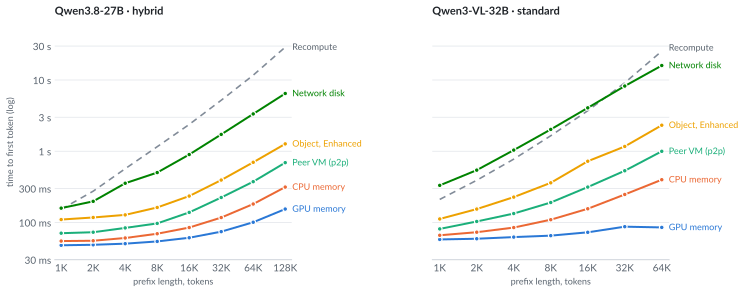
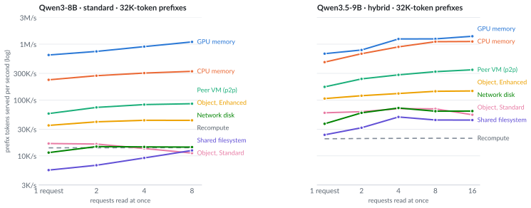
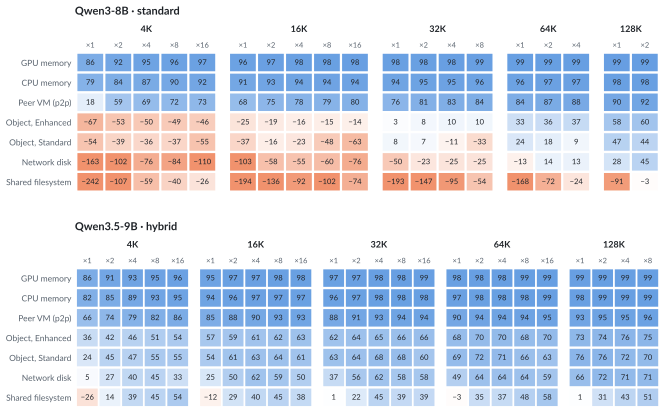
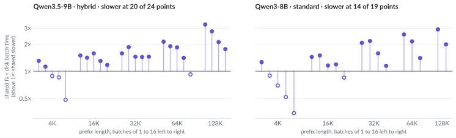

# KV Tier Bench: results

How long does vLLM take to load a cached prompt prefix from each KV-cache tier, and does that beat recomputing it?
This report covers the benchmark's three stages:

- **s1:** one request at a time, on two ~30B models;
- **s2:** batches of up to 16 requests, on two ~9B models;
- **s3:** a CPU-only VM as the KV store (Mooncake Store), against p2p, on s2's models.

It runs on Nebius cloud VMs with one RTX PRO 6000 each (s3 adds a CPU-only VM), using vLLM v0.34.0.

The raw results are [results/s1.jsonl](../results/s1.jsonl), [results/s2.jsonl](../results/s2.jsonl) and
[results/s3.jsonl](../results/s3.jsonl). The aggregated tables behind every figure here are in
[results/report/](../results/report/). The plan, the decisions and the day-by-day findings are in [plan.md](plan.md).

## Summary

- **Recomputing a long prefix is slow, and loading it is fast.** Loading a 64K-token Qwen3-VL-32B prefix from a peer
  VM's memory took 1.0 s; recomputing it took 26 s, **26× longer**. At 128K tokens on Qwen3.8-27B, every tier,
  including a network disk, beat recompute.
- **Prefill doesn't batch; loads do.** Recomputing c prefixes at once took 0.99 × c single prefills (median over
  every batch), so recompute serves the same tokens per second at any batch size. Every tier served more as the
  batch grew, up to its link's limit.
- **Bytes per token decide the storage tiers.** Qwen3-8B stores 144 KiB per token, 3.6–4.5× Qwen3.5-9B. On it,
  Object Storage and the disk pay off only from about 32K tokens; below that, their storage bill outweighs the time
  they save.
- **The shared filesystem lost to the plain disk.** It was slower at 20 of Qwen3.5-9B's 24 points and 14 of
  Qwen3-8B's 19, though fio rated it about 4× faster.
- **p2p has more to give, and s2's region held it back.** A NIXL tuning hook (32 agents per process) made s1's
  long-prefix pulls 5–6× faster, up to 28 GiB/s over TCP. In us-central1 (s2) the same settings reached only
  10–12 GiB/s per pull. s3 re-ran p2p on the same models in eu-south1, and it was a median 1.2× (Qwen3-8B) and 1.6×
  (Qwen3.5-9B) faster, up to 21 GiB/s per batch.
- **A CPU-only KV store did not beat p2p.** Mooncake Store on a CPU-only VM loaded at 2.3–6.0 GiB/s end to end.
  Native p2p, run the same day, loaded a median 2.5× faster. Moving Mooncake's pool onto the peer GPU VM changed
  nothing (a median 1.03× the time).
- **Mooncake's defaults cost about 4×.** Its TCP transport ships with one I/O thread, 4 lanes per peer and 64 KiB
  slices. Tuned, the same reads ran 3.2–4.8× faster. A CPU VM 4× bigger gave more pool room, not more speed.
- **Memory held only for cache needs many reads.** Priced at a CPU-only VM's rate for one hour per read, RAM costs
  more than recomputing at every point. A 128K-token prefix pays for its hour after 15–17 reads on Qwen3-8B and about
  8 on Qwen3.5-9B. A 4K one needs 96 or more on Qwen3-8B.

## Setup

| | Stage 1 (s1) | Stage 2 (s2) | Stage 3 (s3) |
|---|---|---|---|
| Question | One request: load time and cost per tier | Batches of 1–16 requests, each with its own prefix | s2's batches from a CPU-only KV store, against p2p |
| Where | Nebius eu-south1, 2026-11-18 | Nebius us-central1, 2026-11-19 | Nebius eu-south1, 2026-11-19 |
| VMs | 2 spot VMs (the second only for p2p): 1 × RTX PRO 6000 Blackwell (96 GB), 24 vCPU, 218 GB RAM each | same shape | s1's GPU VMs (the second only for p2p and store-p2p) + a CPU-only VM: cpu-d3, 64 vCPU, 256 GiB RAM |
| Models | Qwen3.8-27B (hybrid: Gated DeltaNet 3:1, 64 KiB/token), Qwen3-VL-32B-Instruct (standard, 256 KiB/token) | Qwen3.5-9B (hybrid, 32 KiB/token), Qwen3-8B (standard, 144 KiB/token, YaRN to 160K) | s2's |
| Prefixes | 1K–128K tokens (Qwen3-VL-32B to 64K) | 4K–128K tokens × 1, 2, 4, 8, 16 requests | s2's |
| Tiers | GPU, CPU, network disk, Object Storage (Enhanced), peer VM (p2p) | s1's tiers + Object Storage (Standard) + shared filesystem | Mooncake Store on the CPU-only VM, Mooncake with its pool on a GPU VM (store-p2p, Qwen3-8B only), p2p. Recompute, GPU and CPU reused from s2 |
| Valid points | 390 of 390 | 1,032 of 1,032 | 315 of 315 |

The tiers come from vLLM's `OffloadingConnector` with tiered offloading:
- **GPU and CPU memory:** vLLM's own prefix cache and its CPU tier.
- **Network disk:** a 1,767 GiB non-replicated network SSD (ext4).
- **Shared filesystem:** a 1 TiB Nebius shared filesystem (virtiofs).
- **Object Storage:** in-region buckets, one per storage class, over NIXL's OBJ plugin.
- **p2p:** the second VM's CPU memory, over NIXL/UCX on TCP.

s3's store tiers use vLLM's `MooncakeStoreConnector` instead; they are described in [Stage 3](#stage-3-a-cpu-only-kv-store).

A point counts only if vLLM's own metrics show that every cached token came from the tier under test.

## Stage 1: one request at a time

<picture>
  <source media="(prefers-color-scheme: dark)" srcset="figures/s1-load-time-dark.svg">
  
</picture>

*Median time from sending the request to its first token; 5 reads per point, recompute 2. Log scales.*

GPU and CPU memory answer in under 0.4 s at any length. The other tiers reach, at their best:
- **p2p:** up to 28 GiB/s;
- **Object Storage:** up to 10 GiB/s;
- **network disk:** 1.0–1.4 GiB/s.

The disk is the only tier that recompute can beat. On Qwen3-VL-32B, which stores four times the hybrid model's
bytes per token, it is slower than recomputing up to 32K tokens.

The longest prefix each model ran, with the modelled saving against recompute:

| Tier | Qwen3.8-27B, 128K tokens | Qwen3-VL-32B, 64K tokens |
|---|---|---|
| GPU memory | 0.15 s (99%) | 0.085 s (100%) |
| CPU memory | 0.31 s (99%) | 0.40 s (98%) |
| Peer VM over TCP (p2p) | 0.69 s (98%), 23 GiB/s | 1.00 s (96%), 28 GiB/s |
| Object Storage, Enhanced | 1.3 s (87%), 10 GiB/s | 2.3 s (72%), 9 GiB/s |
| Network disk | 6.5 s (74%), 1.3 GiB/s | 16 s (28%), 1.0 GiB/s |
| Recompute | 30 s | 26 s |

Qwen3-VL-32B stops at 64K tokens. A 128K prefix needs about 32 GiB of KV cache, and only about 25 GB is free next to
its weights on a 96 GB card.

## Stage 2: batches of 1–16 requests

Each request in a batch has its own prefix, and the whole batch is read at once.

<picture>
  <source media="(prefers-color-scheme: dark)" srcset="figures/s2-throughput-dark.svg">
  
</picture>

*Prefix tokens served per second by the whole batch (c × prefix ÷ batch wall time), 32K-token prefixes; median of
3 batches. A batch that does not fit in GPU memory at once is left out, so Qwen3-8B stops at 8.*

At 32K tokens, recompute holds about 14K tokens/s on Qwen3-8B and 20K on Qwen3.5-9B at every batch size. How the
tiers scale:
- **p2p and Object Storage (Enhanced)** gain the most from batching. On Qwen3.5-9B, p2p goes from 172K to 348K
  tokens/s (5.4 to 10.9 GiB/s).
- **The disk** levels off at about 2 GiB/s, its published read cap.
- **Standard Object Storage** slows down as batches grow on Qwen3-8B, from 2.3 to 1.5 GiB/s.

### When a tier saves money

The cost model:
- bills the GPU at $1.80 per hour for the batch's wall time;
- adds each tier's storage price for one hour per prefix;
- compares the total with recomputing the same batch.

The cells show the percentage saved; negative means the tier cost more than recomputing.

<picture>
  <source media="(prefers-color-scheme: dark)" srcset="figures/s2-savings-dark.svg">
  
</picture>

*Columns: prefix length, then requests per batch. Blue saves, orange loses; darker is further from zero.*

On Qwen3.5-9B nearly every tier saves at nearly every point. Qwen3-8B moves 3.6–4.5× the bytes per token:
- **Object Storage (Enhanced):** loads faster than recompute from 4K tokens, but saves only from 32K.
- **Network disk:** faster from 32K × 2, but saves only from 64K × 2.

Between those points, the hour of storage costs more than the GPU time the load saves. A prefix read more than once
an hour would come out ahead.

One 128K-token prefix, tier by tier:

| Tier | Storage, $/GiB-month | Qwen3-8B load | Saved | Qwen3.5-9B load | Saved |
|---|---|---|---|---|---|
| GPU memory | in VM price | 0.14 s | 99% | 0.12 s | 99% |
| CPU memory | in VM price | 0.50 s | 98% | 0.21 s | 98% |
| Peer VM over TCP (p2p) | in VM price | 2.1 s | 90% | 0.66 s | 93% |
| Object Storage, Enhanced | 0.11 | 3.5 s | 58% | 1.2 s | 73% |
| Object Storage, Standard | 0.0147 | 11 s | 47% | 2.0 s | 76% |
| Network disk | 0.053 | 13 s | 28% | 2.5 s | 66% |
| Shared filesystem | 0.08 | 37 s | −91% | 8.1 s | 1% |
| Recompute | | 22 s | | 9.1 s | |

s2 counts the memory of the CPU and p2p tiers as free, part of a VM that is running anyway. Stage 3 also prices it
as memory held only for cache; see [What memory costs](#what-memory-costs).

### The shared filesystem against the disk

fio, 8 MiB direct I/O, 16-way random reads:

| | Shared filesystem (1 TiB) | Network disk |
|---|---|---|
| fio, 16-way reads | 8.2 GiB/s | 1.9 GiB/s |
| fio, single stream | 1.8 GiB/s | 1.7 GiB/s |
| vLLM, one 128K Qwen3-8B prefix | 0.5 GiB/s | 1.4 GiB/s |

On fio the shared filesystem looked like the better fs tier, so it was briefly meant to replace the disk. vLLM's fs
tier disagreed:

<picture>
  <source media="(prefers-color-scheme: dark)" srcset="figures/fs-shared-vs-disk-dark.svg">
  
</picture>

*Batch time from the shared filesystem ÷ batch time from the disk. Filled dots: the shared filesystem was slower.*

vLLM's fs tier stores a prefix as files of 10 MiB and reads them with 16 threads. On the shared filesystem one long
prefix arrived at about 0.5 GiB/s. It pulled ahead only when many prefixes were read at once: 4K tokens with 2–16
requests (up to 2.9× faster on Qwen3-8B), plus 16K × 16 on Qwen3-8B and 64K × 16 on Qwen3.5-9B. A likely cause, not tested: each file open costs more on virtiofs than on ext4, and a
32K prefix is about 100 files. fio read a few large files and never paid that cost.

## Stage 3: a CPU-only KV store

Can a cheap CPU-only VM hold the KV cache for a GPU VM as well as a peer GPU VM can? s3 compares three remote tiers
on s2's models and batches, all over TCP, on the same day in eu-south1:
- **store:** Mooncake Store's master and a 200 GiB memory pool on VM C, a CPU-only VM. vLLM on the GPU VM (A) writes
  and reads it through `MooncakeStoreConnector` as a pure client.
- **store-p2p:** the same connector, but the pool (96 GiB) lives inside vLLM on A, and a second GPU VM (B) reads
  from it. This tests whether the host of the pool matters. Qwen3-8B only.
- **p2p:** s1 and s2's native path (`OffloadingConnector`, NIXL/UCX, 32 agents), with B pulling from A.

Recompute, GPU and CPU were not re-run; they come from s2, in us-central1. The check below shows the recompute times
hold in eu-south1 to within a few percent.

### Rates

Qwen3-8B, batch wall time and the batch's rate end to end (c × prefix × 144 KiB ÷ time); median of 3 batches:

| Prefix × requests | p2p | store-p2p | store (CPU-only VM) |
|---|---|---|---|
| 4K × 1 | 0.093 s, 6.1 GiB/s | 0.169 s, 3.3 GiB/s | 0.158 s, 3.6 GiB/s |
| 4K × 16 | 0.70 s, 12.9 GiB/s | 2.1 s, 4.3 GiB/s | 2.0 s, 4.4 GiB/s |
| 16K × 1 | 0.34 s, 6.6 GiB/s | 0.53 s, 4.2 GiB/s | 0.52 s, 4.3 GiB/s |
| 16K × 16 | 2.4 s, 14.9 GiB/s | 7.4 s, 4.8 GiB/s | 7.3 s, 4.9 GiB/s |
| 32K × 1 | 0.45 s, 10.0 GiB/s | 1.08 s, 4.2 GiB/s | 1.00 s, 4.5 GiB/s |
| 32K × 8 | 2.5 s, 14.4 GiB/s | 7.5 s, 4.8 GiB/s | 7.2 s, 5.0 GiB/s |
| 64K × 1 | 0.90 s, 10.1 GiB/s | 2.1 s, 4.4 GiB/s | 2.0 s, 4.6 GiB/s |
| 64K × 4 | 2.6 s, 13.6 GiB/s | 7.3 s, 4.9 GiB/s | 7.5 s, 4.8 GiB/s |
| 128K × 1 | 1.7 s, 10.5 GiB/s | 4.1 s, 4.4 GiB/s | 4.0 s, 4.5 GiB/s |
| 128K × 2 | 2.8 s, 12.8 GiB/s | 7.8 s, 4.6 GiB/s | 7.7 s, 4.7 GiB/s |
| Recompute (s2) | 128K × 1: 22 s | | |

Qwen3.5-9B (32 KiB per token), p2p against the store:

| Prefix × requests | p2p | store (CPU-only VM) | Recompute (s2) |
|---|---|---|---|
| 4K × 1 | 0.045 s, 3.3 GiB/s | 0.062 s, 2.3 GiB/s | 0.17 s |
| 16K × 16 | 0.50 s, 17.0 GiB/s | 1.6 s, 5.2 GiB/s | 11.7 s |
| 64K × 16 | 1.5 s, 21.4 GiB/s | 5.4 s, 6.0 GiB/s | 58 s |
| 128K × 1 | 0.31 s, 12.9 GiB/s | 0.78 s, 5.2 GiB/s | 9.1 s |
| 128K × 8 | 1.6 s, 20.0 GiB/s | 5.4 s, 6.0 GiB/s | 73 s |

What the rates show:
- **p2p is the fastest remote tier.** Over every matched point the store took a median 2.5× p2p's time: 1.5–3.0× on
  Qwen3-8B and 1.4–3.6× on Qwen3.5-9B. The gap widens with the batch, because p2p keeps scaling and Mooncake does
  not.
- **Mooncake levels off at 5–6 GiB/s.** The store's best batch moved 5.0 GiB/s on Qwen3-8B and 6.0 on Qwen3.5-9B,
  where p2p reached 14.9 and 21.4. Both stores still beat recompute at every point.
- **Where the pool lives does not matter.** store-p2p took a median 1.03× the store's time (0.99–1.09×). The limit
  is Mooncake's own transfer path, not the CPU-only VM.
- **eu-south1 is the faster region for p2p.** At the same points, s3's p2p was a median 1.2× (Qwen3-8B, range
  0.86–1.7×) and 1.6× (Qwen3.5-9B, 1.3–2.1×) faster than s2's in us-central1. That moves s2's p2p gap onto those
  hosts, though its cause is still not known.

### Mooncake's defaults

The first store run used Mooncake's TCP defaults and was 3–5× slower than the table above. Each step below was
measured on the same Qwen3-8B points:

| Store settings | 4K × 1 | 16K × 1 | Time against the final setup (median, range) |
|---|---|---|---|
| Defaults: 1 TCP I/O thread, 4 lanes per peer, 64 KiB slices, 1 vLLM receive thread | 0.51 s | 1.76 s | 3.8× (3.2–4.8, 9 points) |
| 8 I/O threads, 16 lanes | 0.25 s | 0.86 s | 1.6× (1.6–1.8, 7 points) |
| + 4 MiB slices, 4 receive threads (final) | 0.158 s | 0.52 s | 1 |
| Final, on a 16 vCPU, 64 GiB CPU VM (48 GiB pool) | 0.154 s | 0.52 s | 1.00× (0.96–1.05, 16 points) |

The settings are in [configs/experiment.yaml](../configs/experiment.yaml) under `s3.store`, each with the
benchmark behind it. Mooncake's transfer benchmark, from the GPU VM to the CPU-only VM, explains the steps:
- **Into CPU memory,** 8 threads and 16 lanes moved 8.8–11 GiB/s, and 16 threads on the 64 vCPU VM 13.1 GiB/s.
  24 or 32 lanes fell back to about 4 GiB/s.
- **Into GPU memory,** where vLLM's reads land, 64 KiB slices moved 2.3 GiB/s, 4 MiB slices 7.3 GiB/s and 9 MiB
  slices 7.6 GiB/s. A 4× bigger CPU VM did not change that.

vLLM's 5–6 GiB/s sits below the benchmark's 7.6 GiB/s into GPU memory. That is consistent with the GPU-bound
path being the limit, but the remaining gap was not traced.

The bigger CPU VM was still needed, for room. On the 48 GiB pool, Mooncake's master (which evicts from 90% full,
with a 10 s lease by default) evicted parts of large batches before they were read: 2 of the 50 batches recorded
were invalid. The run in the tables used a 200 GiB pool and a 60 s lease.

Writing to the store also slows the prefill that writes it. At the same lengths, the write phase took up to 1.11×
p2p's on Qwen3-8B and 1.14–1.22× on Qwen3.5-9B from 16K up. The cost model counts reads only, so this is not in the
savings below.

### What memory costs

s1 and s2 count p2p's memory as free. That fits a peer VM that runs anyway, for its own traffic. A node that holds
KV and nothing else pays for its memory, and s3 prices that case: RAM at a CPU-only VM's rate, $6.02 per GiB-month
($0.0083 per GiB-hour), held for one hour per read. On Nebius the GPU VM's RAM costs the same per GiB-hour. The
price applies to p2p, store and store-p2p alike.

With the memory priced, every point costs more than recomputing, from −630% to −5,200%. That figure is almost
entirely one hour of RAM against a few seconds of GPU, and barely depends on how fast the tier is. A better
question is how often a prefix must be read in its hour to pay for it:

| Prefix (1 request) | Qwen3-8B p2p | Qwen3-8B store | Qwen3-8B store-p2p | Qwen3.5-9B p2p | Qwen3.5-9B store |
|---|---|---|---|---|---|
| 4K | 96 | 295 | 461 | 19 | 22 |
| 16K | 63 | 92 | 93 | 13 | 14 |
| 32K | 39 | 55 | 58 | 11 | 12 |
| 64K | 26 | 31 | 32 | 9.7 | 10 |
| 128K | 15 | 17 | 17 | 7.5 | 7.9 |

*Reads per prefix per hour at which the RAM's cost equals the GPU time saved against recompute.*

Long prefixes and few bytes per token pay back soonest. The faster tier needs fewer reads, most of all at 4K, where
the store saves little time per read.

With the memory free, the remote tiers save as much as s2's did. One 128K-token request: p2p saves 92% on Qwen3-8B
and 97% on Qwen3.5-9B; the store saves 81% and 91%.

Two notes on the price:
- **It assumes a full pool.** Storage is billed on bytes used. The CPU-only VM as run cost $2.11/h on demand, more
  than the GPU VM's $1.80, whatever it held; its 200 GiB pool alone comes to $1.65/h at the RAM rate.
- **Object Storage is far cheaper per byte.** In s2, Enhanced Object Storage loaded one 128K Qwen3-8B prefix in
  3.5 s, against the store's 4.0 s here, at $0.11 per GiB-month against $6.02. The two ran in different regions.

### Checks on s3

- **Validity.** All 105 points have 3 valid batches. Three store-p2p batches (32K × 8, 64K × 4, 128K × 2) failed
  their first attempt, because the 96 GiB pool on A had evicted part of the batch, and passed on retry. The store
  runs with the default and partly tuned settings, and on the smaller CPU VM, are kept apart in
  [results/](../results/) as `s3-store-*.jsonl`.
- **The reused baselines.** s3's write phase prefills each prefix on A, the same work as a recompute. For p2p it took
  1–7% longer than s2's recompute at the same lengths (7% only at 4K on Qwen3-8B, 3% or less elsewhere), and within
  4% of s2's own write phase. So s2's recompute times stand for eu-south1 to within a few percent. If anything they
  understate s3's savings slightly: by up to 5 points at 4K, 1–2 points elsewhere.

## How close to the ceiling

Each tier's published limits next to what vLLM got out of it. The measured side comes from two places:
- **s1's single requests, fitted as** load time = fixed cost + bytes ÷ rate (R² 0.997–1.000 for every tier that
  moves data). The fixed cost is shown above a GPU hit, which already costs vLLM 46–62 ms per request (the HTTP
  round trip, scheduling and one decode step).
- **The best batch rate from s2 and s3,** end to end.

| Tier | Published ceiling | Fixed cost above a GPU hit | Rate, one request (s1) | Best batch rate (s2, s3) | Capacity |
|---|---|---|---|---|---|
| GPU memory | 96 GB GDDR7 at 1,597 GB/s [^gpu] | — | no transfer | no transfer | 96 GB card; 25–67 GiB of it left for KV after weights |
| CPU memory | PCIe 5.0 x16: 63 GB/s (58.7 GiB/s) each way [^pcie] | +4 ms | 31–47 GiB/s (53–80% of PCIe) | not measured (no byte counter) | 218 GiB VM RAM [^vm]; 48 GiB used |
| Peer VM (p2p) | NIC: BlueField-3, 400 Gbps (46.6 GiB/s) [^vm]; iperf3 between the VMs: 27.4 GiB/s | +12 ms | 13–17 GiB/s end to end; the network pull alone 23–28 GiB/s | 12.3 GiB/s in us-central1 (s2); 21.4 GiB/s in eu-south1 (s3) | the peer's RAM |
| CPU-only store (Mooncake, s3) | none found for cpu-d3; iperf3 from the GPU VM: 5.9 GiB/s on one thread (a floor); Mooncake's own benchmark: 13.1 GiB/s into CPU memory, 7.6 GiB/s into GPU memory | — | not in s1 | 5.0 GiB/s (Qwen3-8B), 6.0 GiB/s (Qwen3.5-9B) | the CPU VM's RAM: 256 GiB, 200 GiB pool |
| Object Storage, Enhanced | unthrottled [^obj]; 1 TiB per region by default quota [^objq] | +31–40 ms | 7 GiB/s | 6.2 GiB/s | quota-bound |
| Object Storage, Standard | 20 GB/s per tenant per region [^obj] | — | not in s1 | 2.5 GiB/s | unlimited |
| Network disk (1,767 GiB) | 2 GiB/s read, 1.5 GiB/s write, 75K read IOPS at this size; 110 MiB/s read per 93 GiB unit [^disk]; fio: 1.94 GiB/s | +9–23 ms | 1.0–1.3 GiB/s (50–65%) | 2.0–2.6 GiB/s | up to 256 TiB per disk [^disk] |
| Shared filesystem (1 TiB) | 3.70 GiB/s read per 4 TiB of size, up to 15 GiB/s per client [^disk]; fio: 8.2 GiB/s | — | not in s1 | 5.6 GiB/s (16 × 4K); 0.5 GiB/s for one 128K prefix | up to 100 PiB [^disk] |

What the comparison shows:
- **Fixed costs are vLLM's, not the tiers'.** A GPU hit already costs 46–62 ms per request, and the tiers add
  4–40 ms. Below a few thousand tokens the choice of tier hardly matters; above that, only the rate does.
- **CPU memory gets half to most of PCIe 5.0.** That is the copy into GPU memory, the hop that every other tier also
  ends with.
- **p2p loses half its network speed after the network.** The pull reaches 23–28 GiB/s, yet one request loads at
  13–17 GiB/s end to end. That gap is consistent with the pull into the local VM's CPU memory and the copy to the
  GPU running one after the other; overlapping them is the next thing to try.
- **The disk ends up at its cap.** A single read gets 50–65% of the 2 GiB/s limit, and 2–16 reads at once reach
  2.0–2.3 GiB/s, peaking at 2.6 on a few short batches (a burst allowance or a cache; fio's 60-second run held
  1.94). The limit grows with disk size only up to 1,767 GiB (19 units), so a bigger disk would not read faster. Only
  more disks, striped, would.
- **The shared filesystem beat its quote on fio but not in vLLM.** At 1 TiB the quoted rate works out to about
  0.9 GiB/s. fio read 8.2 GiB/s, probably helped by a cache. vLLM got 0.5 GiB/s for one long prefix and up to 5.6 GiB/s
  for sixteen 4K prefixes at once.
- **Mooncake's store reaches 66–79% of its own transfer benchmark into GPU memory,** and under half of what the
  same benchmark moves into CPU memory. Its TCP path, not the CPU-only VM, is the limit (see
  [Mooncake's defaults](#mooncakes-defaults)).
- **Object Storage, Enhanced** has no published bandwidth cap. vLLM's NIXL OBJ path reached 7–10 GiB/s, and this
  run did not find the store's limit.

[^gpu]: [NVIDIA RTX PRO 6000 Blackwell Server Edition](https://www.nvidia.com/ko-kr/data-center/rtx-pro-6000-blackwell-server-edition/). NVIDIA lists 1,792 GB/s for the Workstation Edition.
[^pcie]: PCIe 5.0 runs 32 GT/s per lane with 128b/130b encoding: 16 lanes × 32 GT/s ÷ 8 × 128/130 ≈ 63 GB/s each way, before protocol overhead.
[^vm]: [Nebius VM types](https://docs.nebius.com/compute/virtual-machines/types), `1gpu-24vcpu-218gb` preset. The page does not say whether the 400 Gbps adapter is per VM or shared by the server's 8 GPUs.
[^obj]: [Nebius Object Storage classes](https://docs.nebius.com/object-storage/storage-classes).
[^objq]: [Nebius Object Storage quotas](https://docs.nebius.com/object-storage/resources/quotas-limits).
[^disk]: [Nebius disk and filesystem types](https://docs.nebius.com/compute/storage/types), read November 2026.

## How it was measured

- **One prefill per length.** Each prefix is prefilled once, and vLLM writes it through to every tier. Each read
  then resets the tiers above the one under test, so the read must come from that tier.
- **Batches in s2 and s3.** A batch's prefixes are written one at a time, each settled before the next, then all
  read at once. The baseline is the recompute batch at the same length and size; s3 reuses s2's.
- **Validity.** A batch is valid only if the summed cached tokens by source equal c × prefix for the tier under
  test. vLLM labels Mooncake's hits only as "external", so in s3 a store batch must also show, in Mooncake's own
  counters, at least 90% of the batch's KV bytes loaded and no failed keys.
- **What is measured and what is modelled.** Times and rates are measured. Savings are modelled:
  - the GPU at $1.80/h on demand (the runs paid spot: $1.38 in eu-south1, $1.19 in us-central1);
  - each prefix stored for one hour per read;
  - in s3, the RAM behind p2p and the store at $6.02 per GiB-month, with the free-RAM case alongside;
  - storage billed on bytes used;
  - Standard Object Storage request fees ($0.0034 per 1,000 writes) left out.

  Prices are from docs.nebius.com, November 2026, and live in [configs/prices.yaml](../configs/prices.yaml).
- **Rates.** s1's GiB/s is one request's transfer rate. s2's and s3's are the whole batch's rate end to end,
  including the copy into GPU memory and the one-token prefill. s1's and the later stages' rates are not comparable.

## Limits

- **p2p in us-central1 is a floor.** It moved 10–12 GiB/s per pull, against about 23 GiB/s in eu-south1 with the
  same NIXL settings, and concurrent pulls stopped adding up near 11 GiB/s. iperf3 between the VMs reached
  27 GiB/s, so the limit is in NIXL/UCX on those hosts. s3's p2p, on the same models in eu-south1, was 1.2–1.6×
  faster (median), which confirms a regional gap. Its cause was not diagnosed.
- **TCP only.** The VMs have no RDMA or NVLink between them, for p2p and Mooncake alike. Mooncake also speaks RDMA;
  with it, the store might close some of the gap to p2p.
- **s3's baselines are from s2.** Recompute, GPU and CPU were measured in us-central1. The write-phase check in
  [Checks on s3](#checks-on-s3) puts the error at a few percent.
- **One excluded run.** The first disk run on Qwen3.5-9B at times delivered 3.1–3.8 GiB/s, above the disk's fio
  ceiling, so part of it probably came from a cache. It is kept apart in
  [results/s2-fs-nrd-disk.jsonl](../results/s2-fs-nrd-disk.jsonl) and not used. The run shown mostly reads at
  2.0–2.3 GiB/s from 2 requests up, and peaks at 2.6 on a few short batches.
- **One request shape.** s2 and s3 have no decode traffic running during the loads, no mixed or trace-driven workloads, and
  no GPU bigger than 96 GB.

## Reproduce

```bash
uv run kvtb cost --stage s2 --results results/s2.jsonl      # the cost table, one row per point
uv run kvtb cost --stage s3 --results results/s3.jsonl      # s3, with s2's baselines and the RAM-priced columns
uv run python scripts/export-report-data.py                 # results/report/*.json
uv run python scripts/report-figures.py                     # docs/figures/*.svg
```

Running the benchmark itself (VMs, weights, the sweep) is in the runbook in [plan.md](plan.md#runbook).
